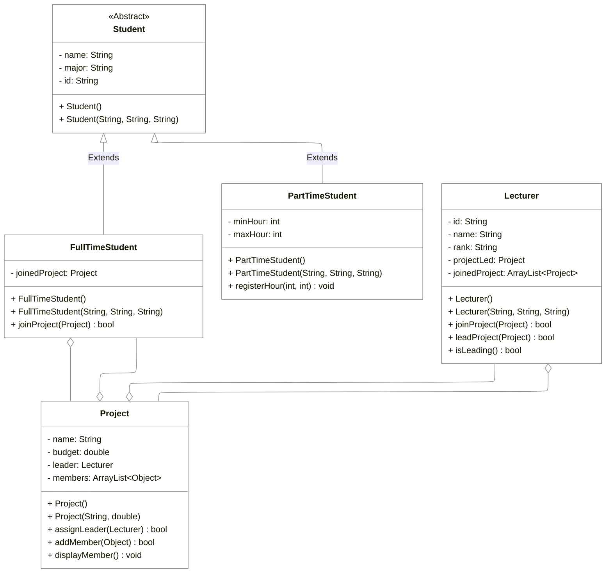

# COSC2731 - Week 1 Code

## Question 2 – Solution (UML class diagram)



## Question 3 – Implement Student class

### problem3/Student.java

```java
package problem3;

/**
 * @author COSC2440 Teaching Team
 * @version 1.0
 */

public class Student {
    private String studentId;
    private String fullName;
    private String major;

    public  Student() {
        this.studentId = "Default";
        this.fullName = "Default";
        this.major = "Default";
    }

    public Student(String studentId, String fullName, String major) {
        this.studentId = studentId;
        this.fullName = fullName;
        this.major = major;
    }

    // Getter and setter methods
    public String getStudentId() {
        return studentId;
    }

    public void setStudentId(String studentId) {
        this.studentId = studentId;
    }

    public String getFullName() {
        return fullName;
    }

    public void setFullName(String fullName) {
        this.fullName = fullName;
    }

    public String getMajor() {
        return major;
    }

    public void setMajor(String major) {
        this.major = major;
    }
}

```

### problem3/StudentTest.java

```java
package problem3;

/**
 * @author COSC2440 Teaching Team
 * @version 1.0
 */

public class StudentTest {
    public static void main(String[] args) {
        /*
          Create Student objects and access their attributes
         */
        Student stu1 = new Student("s123", "John Smith", "IT");
        System.out.println(stu1.getStudentId() + " "  + stu1.getFullName() + " " + stu1.getMajor());

        Student stu2 = new Student();
        stu2.setStudentId("s345");
        stu2.setFullName("Taylor Swift");
        stu2.setMajor("SE");
        // another way to print data
        System.out.printf("%s %s %s\n", stu2.getStudentId(), stu2.getFullName(), stu2.getMajor());
    }
}

```

### problem3_2/StudentTest2.java

```java
package problem3_2;

import problem3.Student;

/**
 * @author COSC2440 Teaching Team
 * @version 1.0
 */

public class StudentTest2 {
    public static void main(String[] args) {
        /*
          Create Student objects and access their attributes
         */
        Student stu1 = new Student("s123", "John Smith", "IT");
        /*
          To access Student class in this package,
          either use its fully-qualified name (name with the prefix package name),
          or "import" it first, then use it as it is in the same package
         */
        // problem3.Student stu = new problem3.Student();
        System.out.println(stu1.getStudentId() + " "  + stu1.getFullName() + " " + stu1.getMajor());

        Student stu2 = new Student();
        /*
          From Java 10, if the type of a variable can be determined automatically,
          you can use "var" to declare its type. For example
          var stu = new Student();
         */
        stu2.setStudentId("s345");
        stu2.setFullName("Taylor Swift");
        stu2.setMajor("SE");
        // another way to print data
        System.out.printf("%s %s %s\n", stu2.getStudentId(), stu2.getFullName(), stu2.getMajor());
    }
}

```

## Question 4 – Implement Project and Lecturer class

### problem4/Lecturer.java

```java
package problem4;

/**
 * @author COSC2440 Teaching Team
 * @version 1.0
 */

public class Lecturer {
    private String employeeId;
    private String fullName;
    private String rank;
    private Project projectLed;
    // assume the maximum number of projects a lecturer can join at one time is 10
    private final int MAX_PROJECTS = 10;
    private Project[] joinedProjects;
    private int projectCount = 0;

    public Lecturer()  {
        this.employeeId = "Default";
        this.fullName = "Default";
        this.rank = "Default";
        joinedProjects = new Project[MAX_PROJECTS];
    }
    public Lecturer(String employeeId, String fullName, String rank) {
        this.employeeId = employeeId;
        this.fullName = fullName;
        this.rank = rank;
        joinedProjects = new Project[MAX_PROJECTS];
    }

    /**
     * assign the current lecturer as the leader of a project
     * <p>
     * Given a project, assign the current lecturer as its leader.
     * If the assignment is successful, return true,
     * otherwise, return false
     * </p>
     * @param p the project to lead
     * @return true if the assignment is successful, otherwise, return false
     */
    public boolean leadProject(Project p) {
        /*
          two conditions below must satisfy
          the lecturer has no project to lead
          the assigned project has no leader
         */
        if (!isLeading() && p.getLeader() == null) {
            projectLed = p;
            p.assignLeader(this);
            return true;
        }
        return false;
    }

    /**
     * assign the current lecturer as a member of a project
     * <p>
     * Join a project as a member. It's the job of the Project class
     * to check for validity of this action or to check if
     * this Lecturer member exists in the project already
     * </p>
     * @param p the project to join
     * @return true if the assignment is successful, otherwise, return false
     */
    public boolean joinProject(Project p) {
        // Short-circuit evaluation, if the first condition is false
        // the second condition will not be evaluated
        if (projectCount < 10 && p.addMember(this)) {
            this.joinedProjects[projectCount++] = p;
            return true;
        }
        return false;
    }

    /**
     * check if the current lecturer is leading any project
     * @return true if the current lecturer is leading any project, false if not
     */
    public boolean isLeading() {
        return projectLed != null;
    }

    public String getEmployeeId() {
        return employeeId;
    }

    public String getFullName() {
        return fullName;
    }

    public String getRank() {
        return rank;
    }

    public Project[] getJoinedProjects() {
        return joinedProjects;
    }

    /**
     * set the rank of a lecturer
     * <p>
     * Given a rank, assign the rank for the current lecturer
     * If the assignment is successful, return true,
     * otherwise, return false
     * </p>
     * @param rank the rank to set for the lecturer
     * @return true if the assignment is successful, otherwise, return false
     */
    public boolean setRank(String rank) {
        String [] rankList = {"Assoc Lecturer" , "Lecturer", "Senior Lecturer"};
        boolean checked = false;
        for (String availableRank: rankList){
            if (availableRank.equals(rank))
                checked = true;
        }
        if (checked){
            this.rank = rank;
            return true;
        }
        return false;
    }

    /**
     * String representation of this lecturer
     * <p>
     * This method is called automatically when you use a Lecturer object
     * in places where a String value is required.
     * </p>
     */
    @Override
    public String toString() {
        // String.format() is similar to printf, but it return instead of display
        return String.format("Id: %s, Name: %s, Rank: %s",
                employeeId, fullName, rank);
    }
}

```

### problem4/Project.java

```java
package problem4;

/**
 * @author COSC2440 Teaching Team
 * @version 1.0
 */

public class Project {
    private String name;
    private double budget;
    private Lecturer leader;
    private Lecturer[] members;
    private final int MAX_MEMBERS = 10;
    private int memberCount = 0;

    public Project() {
        this.name = "Default";
        this.budget = 0;
        members = new Lecturer[MAX_MEMBERS];
    }
    public Project(String name, double budget) {
        this.name = name;
        this.budget = budget;
        members = new Lecturer[MAX_MEMBERS];
    }

    /**
     * get the current leader of this project
     * @return the Lecturer who is the leader,
     * or null if there is no leader for this project
     */
    public Lecturer getLeader() {
        return leader;
    }

    /**
     * assign a new leader for this project
     * <p>
     * Assign the given Lecturer as the new leader for this project.
     * It's the job of the Lecturer class to ensure this assignment
     * is valid. This class just does the assignment
     * </p>
     * @param leader the new leader for this project
     */
    public void assignLeader(Lecturer leader) {
        this.leader = leader;
    }

    /**
     * add a new member to this project
     * <p>
     * Add a new member to this project. At this point, there
     * is no checking at all
     * </p>
     * @param newMember a Lecturer who want to join this project
     */
    public boolean addMember(Lecturer newMember) {
        if (memberCount == MAX_MEMBERS)
            return false;
        /*
           Assume duplication has been handled when adding a new member
           so we do not have to check it
         */
        members[memberCount++] = newMember;
        return true;
    }


    /**
     * display all members in this project (including leader and regular member)
     */
    public void displayMembers() {
        // display leader
        System.out.println("Leader: " + leader);

        // display regular members
        for(int i = 0; i < memberCount; i++) {
            System.out.printf("Member #%d: " + members[i] + "\n", i + 1);
        }
    }
}

```

### problem4/SchoolSystem.java

```java
package problem4;

/**
 * Test program for the implementation of Lecturer and Project
 * @author COSC2440 Teaching Team
 * @version 1.0
 */

public class SchoolSystem {
    public static void main(String[] args) {
        Lecturer lecturer1 = new Lecturer("L001", "Alice", "Lecturer");
        Lecturer lecturer2 = new Lecturer("L002", "Bob", "Senior Lecturer");
        Lecturer lecturer3 = new Lecturer("L003", "Carol", "Assoc Lecturer");

        Project p1 = new Project("AI", 999.9);
        Project p2 = new Project("ML", 1234.5);

        // Must display true
        boolean b = lecturer1.leadProject(p1);
        System.out.println(b);

        // Must display false (p1 has a leader already)
        b = lecturer2.leadProject(p1);
        System.out.println(b);

        // Must display false (lecturer1 is leading a project)
        b = lecturer1.leadProject(p2);
        System.out.println(b);

        // Must display lecturer1 as a leader and lecturer2 and lecturer3 as members
        lecturer2.joinProject(p1);
        lecturer3.joinProject(p1);
        p1.displayMembers();
    }
}

```
