# Software Design & Java Basics

## Learning Outcomes

- **Describe** the three broad phases of Software Development: Analysis, Design and Implementation
- **Describe** the basic structure of an OO system and how to initially identify classes, methods, attributes and relationships
- **Explain** the purpose of Encapsulation and Information Hiding
- **Describe** Coupling and Cohesion and **Explain** the Coupling/Cohesion trade-off
- **Introduce** Java basic components and syntax

# Part 1: Software Design

## Object-Oriented Development

In general, development consists of three broad activities.

- These can be further subdivided but conceptually activities generally fall into one of these broader categories

1. Analysis (OOA)
   - Understanding and defining the problem
2. Design (OOD)
   - A high-level conceptual solution expressed using diagrams, pseudocode, etc.
3. Programming (OOP)
   - A detailed solution implemented in a programming language such as Java, C#, C++, etc.
   - The Java Language Specification is the definitive reference for Java coding conventions: Code Conventions for the Java Programming Language

## Example: a Bank System

Take the example of a **bank**.

- The **bank** stores data about its **customers**.
- A **customer** has a name, a customer number, a password and one or more accounts.
- An **account** is identified by an account number and has a balance.
- A customer can perform withdrawals, deposits and balance queries on their accounts.

Questions:

- How can we **discover classes** (and their relationships)?
- How can we **discover attributes (fields/instance variables) and methods for each class**?

## System Structure - Discovering Classes and Relationships

- Classes are often either a **concrete entity** (a student, or a course), or an abstract concept or category (a shape, or form of transport)
- A simple starting point (rule of thumb) for discovering classes is to look for **nouns** in the problem specification or significant **concepts** or **artefacts**
- Class relationships can take different forms: **association**, **aggregation**, **composition** and **inheritance**
- When determining **cardinality** (number of instances in a relationship, e.g., one to many or many to many) over-estimate rather than underestimate

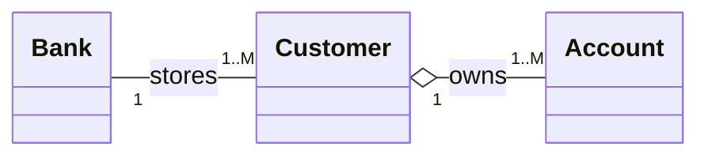

## Discovering Attributes

To discover attributes, ask questions such as: "I am an account. What should I know? What do I need to remember? What properties do I have? What states can I be in?"

- My account number?
- My account balance?
- My owner?
- My bank?

For each attribute, you need to decide on its name, data type, visibility (public, protected, private or default (package)), also any modifiers i.e., should it be a constant (final) or variable, and have instance or class scope (static).

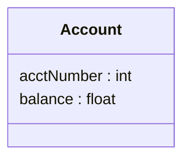

## System Behaviour - Discovering Methods and Relationships

Ask questions such as: "I am an account. What services should I provide?" "What expertise should I have?" "What is my role?" "Who will be using me?" "Who do I interact with?" "What can be done with the attributes?"

- Query my account number?
- Query my account balance?
- Change my account number?
- Change my balance?
- Deposit or withdraw money?

Like attributes, for each method you also need to decide on its name, data types (for parameters and return value), visibility (public, protected, private or default (package)), and whether it should be final (not overridable) or static (called at the class level).

Tip: look for verbs in the problem specification.

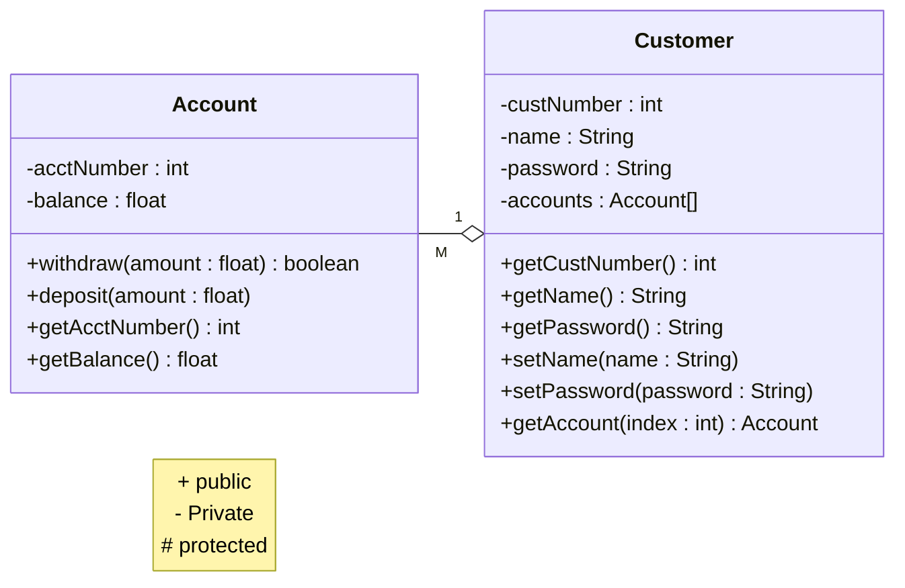

Each class encapsulates its own data (attributes) and methods according to its own specific semantics.

## Encapsulation and Information Hiding

Now that Java's basic object capabilities have been detailed, we can review the fundamentals of **good OO design** with a **focus on implementation**.

- **Encapsulation** means that both attributes (state) and methods (behaviour) are contained (encapsulated) within a single code module (class).
- **Information hiding** means that only methods of a class have access to private information (usually the attributes (state) of the class but can have private methods as well)
- Therefore, outside access to the class' internals are on a **"need to know basis"**
- TIP: If in doubt restrict visibility (private) and open up later if really necessary.

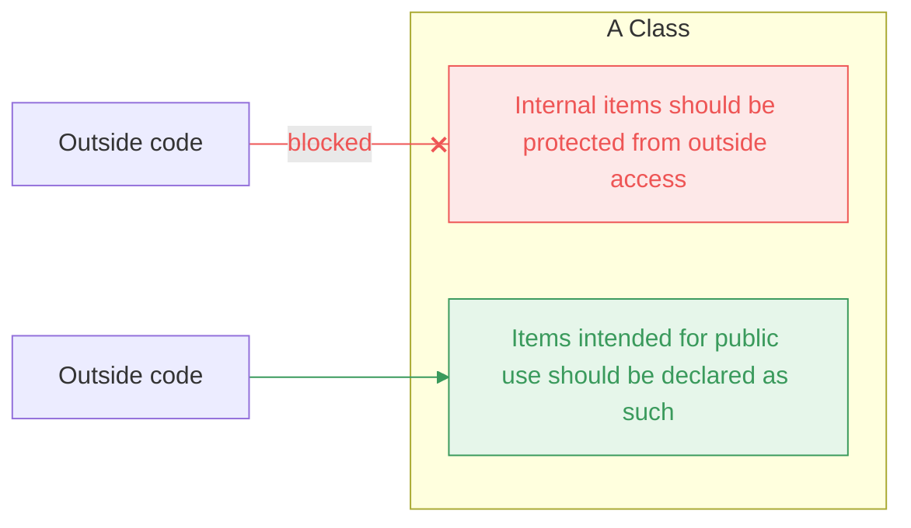

### Java Access Modifiers

| Modifier on members in a class | Accessed from the same class | Accessed from the same package | Accessed from a subclass | Accessed from a different package |
|---|---|---|---|---|
| public | ✓ | ✓ | ✓ | ✓ |
| protected | ✓ | ✓ | ✓ | – |
| default | ✓ | ✓ | – | – |
| private | ✓ | – | – | – |

From Liang, Introduction to Java Programming, Sixth Edition, (c) 2007 Pearson Education, Inc. All rights reserved. 0-13-222158-6

## Object Oriented Design

- As we have seen **object-oriented programming** is based on a **number of objects working together** to perform a function.
- This kind of approach to developing code can give a number of benefits, such as easier **code maintenance** and enhanced **re-usability**.
- However, a **poorly designed** object-oriented program can be **just as, if not more difficult to use and maintain** than if it were developed using procedural or functional approaches.

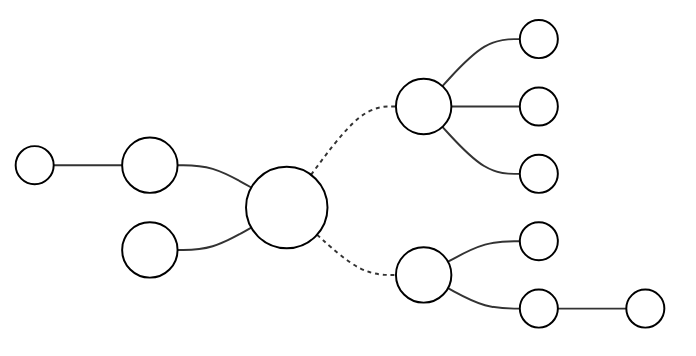

*Left: a developers' object-oriented program. Right: existing, re-usable software components.*

### Coupling

- Classes should be properly **encapsulated**. This refers to each class holding all the data/functionality it requires to fulfil its purpose, without being unduly dependent on others
- The dependence of some classes on others in this context is called **coupling**. This reliance should be minimised in your class designs wherever possible
- **Excessive coupling** between classes **can create problems** when items are modified – with so many dependencies, changing one will imply that many others may also need to be changed
- Coupling can be **objectively measured** with automated code analysis tools

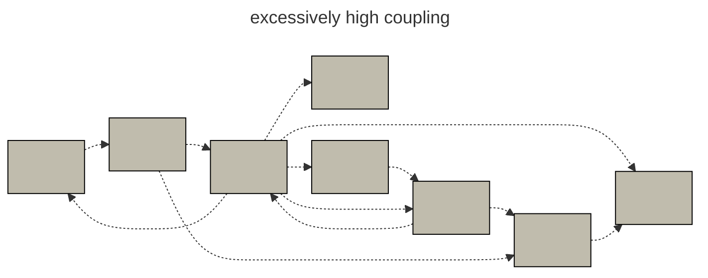

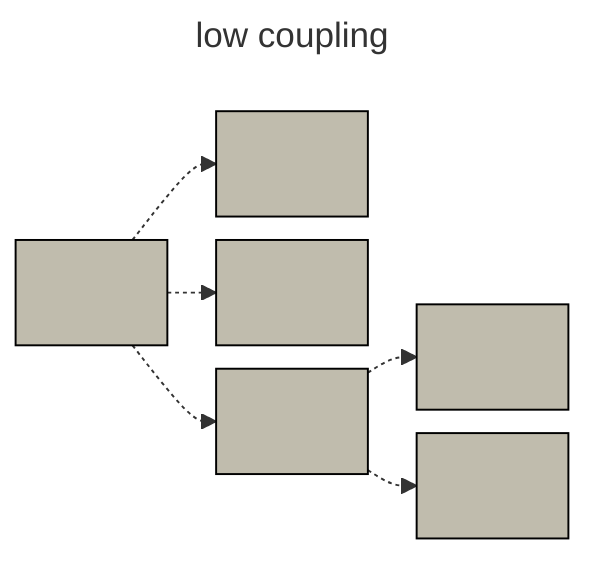

### Cohesion

- When a class is designed, each of its elements should have a **logical and well-defined role** in the class being able to fulfil its purpose. This **tight relation** of internal components is known as **cohesion**
- A **highly cohesive object** will **not** have items that are **only loosely related** to its role – the object will define **one** concept or perform one task well
- Cohesion is a **good** thing – it reflects a design that is **very clear and pure** to its intended purpose
- Cohesion is harder to measure automatically since it requires semantic understanding
- Coupling and Cohesion is a tradeoff – increasing cohesion (good) can increase coupling (bad)

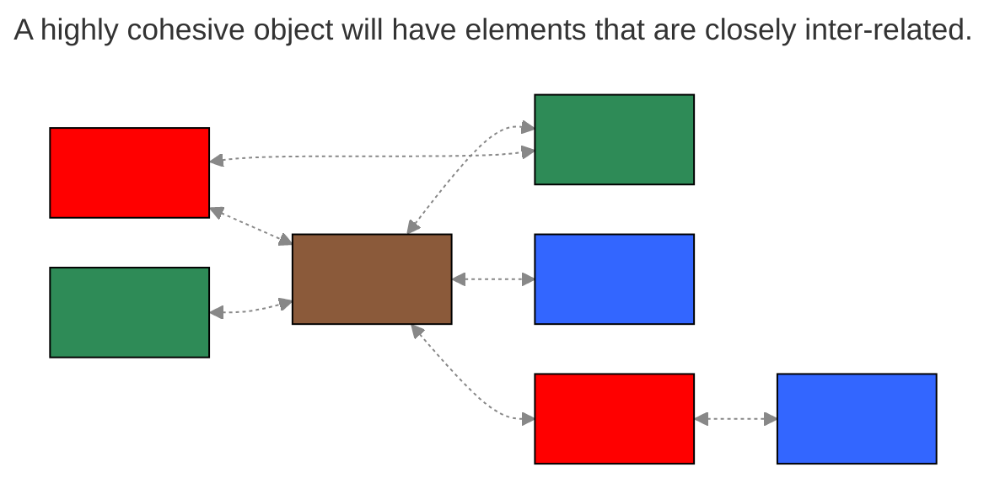

### Cohesion and Coupling Trade-off

Cohesion and coupling are a trade-off

- Improving one may have a negative impact on the other

e.g., Consider a program with only one class

- It has low coupling (good) since there are no other classes to couple to
- However, cohesion will be low (bad) because the class will be responsible for everything like user interface, database management, unrelated domain logic (accounts, customers, etc.)
- => Lots of unrelated methods = not cohesive

**TIP: Write cohesive classes first then try to minimize coupling**

Conversely, imagine a system with a large number of very small and highly cohesive classes that only have one method

- One method implies only a single functionality (although the method itself may not be cohesive) so class level cohesion is high (good)
- However, this system will be highly coupled (bad) because all the small classes have to interact to get work done

### SUMMARY: "Good" Object-Oriented Program Design

An object-oriented program design should:

- have all internal information well protected from others
- have classes that have a clear and focused purpose (maximise cohesion)
- consist of classes that are highly independent (minimise coupling)
- TIP: a common beginners mistake is to have **too few** classes

Adhering to these fundamental design principles should help design object-oriented programs that are **easily understood**, **easily maintainable**, and consist of **highly reusable** components (i.e., quality software, see next slide).

A good program design can **save a lot of time** when it comes to implementation, by eliminating the need for "hacking and patching" code and class models to make them work.

## OOD Notation – A Diagrammatic Approach

- Class diagrams show the structure of a program at the class level, showing
  - methods and attributes of classes
  - relationship between classes (e.g., inheritance, association)
- Can range from low detail (classes and relationships only) to high detail (e.g., full method signatures, visibility etc.)
- Class diagrams are part of a modelling language (UML)
- Class diagrams can be generated from code and skeleton code can be generated from diagrams

### Class Diagram – Notations

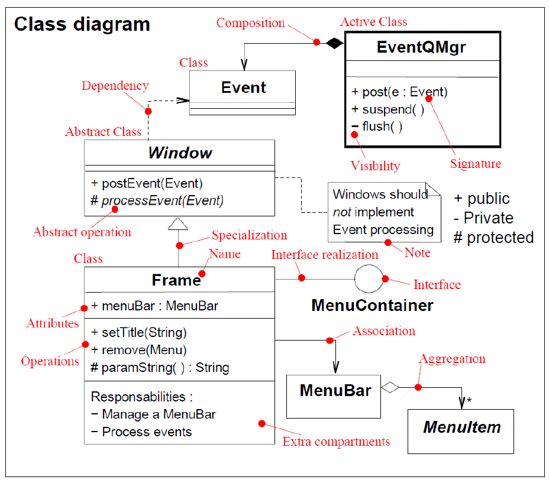

### Example UML Class Diagram

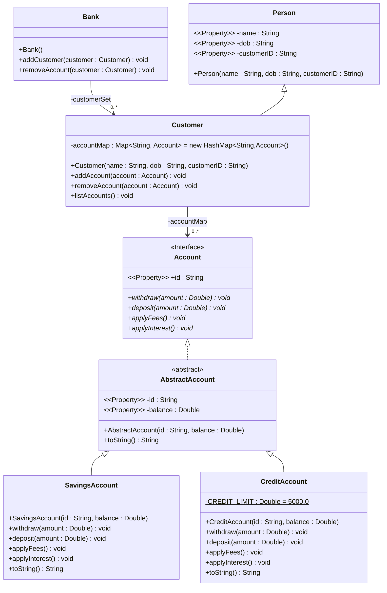

## Javadoc Comments

- Javadoc is an in-built commenting format used to document code in Java
- It consists of two parts:
  - in-code annotations within a comment of the form `/** ... */`
  - A generator program javadoc.exe which creates html documentation (complete with structure and hyper-linking) from the markup comments in the code
- The API documentation for Java has been built using this approach
- Can generate at class or package granularity
- Some of the common annotations are given on the next slide

### Javadoc Annotations

| Tag & Parameter | Usage | Applies to |
|---|---|---|
| **@author** *John Smith* | Describes an author. | Class, Interface, Enum |
| **@version** *version* | Provides software version entry. Max one per Class or Interface. | Class, Interface, Enum |
| **@since** *since-text* | Describes when this functionality has first existed. | Class, Interface, Enum, Field, Method |
| **@see** *reference* | Provides a link to other element of documentation. | Class, Interface, Enum, Field, Method |
| **@param** *name description* | Describes a method parameter. | Method |
| **@return** *description* | Describes the return value. | Method |
| **@exception** *classname description*<br>**@throws** *classname Description* | Describes an exception that may be thrown from this method. | Method |
| **@deprecated** *description* | Describes an outdated method. | Method |

### Javadoc Examples (1)

Author, version, since

```java
// import statements

/**
 * @author      Firstname Lastname <address @ example.com>
 * @version     1.6                 (current version number of program)
 * @since       1.2          (the version of the package this class was first added to)
 */
public class Test {
    // class body
}
```

Method description

```java
/**
 * Short one line description.                           (1)
 * <p>
 * Longer description. If there were any, it would be    (2)
 * here.
 * <p>
 * And even more explanations to follow in consecutive
 * paragraphs separated by HTML paragraph breaks.
 *
 * @param  variable Description text text text.          (3)
 * @return Description text text text.
 */
public int methodName (...) {
    // method body with a return statement
}
```

### Javadoc Examples (2)

Attribute description

```java
/**
 * The horizontal distance of point.
 */
public int x;

/**
 * The vertical distance of point.
 */
public int y;
```

Reference to others

```java
/**
 * Validates a chess move.
 *
 * <p>Use {@link #doMove(int fromFile, int fromRank, int toFile, int toRank)} to move a piece.
 *
 * @param fromFile file from which a piece is being moved
 * @param fromRank rank from which a piece is being moved
 * @param toFile   file to which a piece is being moved
 * @param toRank   rank to which a piece is being moved
 * @return            true if the move is valid, otherwise false
 * @since             1.0
 */
boolean isValidMove(int fromFile, int fromRank, int toFile, int toRank) {
    // ...body
}

/**
 * Moves a chess piece.
 *
 * @see java.math.RoundingMode
 */
void doMove(int fromFile, int fromRank, int toFile, int toRank)  {
    // ...body
}
```

# Part 2: Introduction to Java

## What is Java?

- High-level programming language invented in 1995 by James Gosling and his colleagues at Sun Microsystem (later acquired by Oracle)
- Java source files (.java) are compiled into Java bytecode (.class) which can be executed by the Java Virtual Machine (JVM)
- Works on anything that has a JVM implementation (computers, supercomputers, smartphones, game consoles, etc.)

## Why Java?

How does a typical program run?

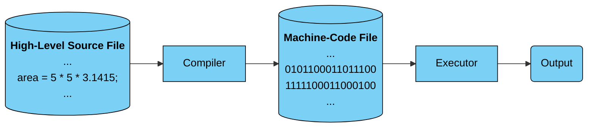

But there are several platforms (Windows, macOS, Linux, UNIX, Android, iOS, etc.), thus a program must be **ported** to those platforms before it can be run

With Java, we can "write once, run anywhere"

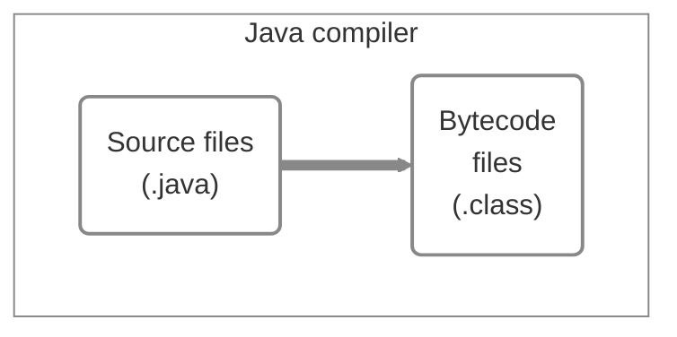

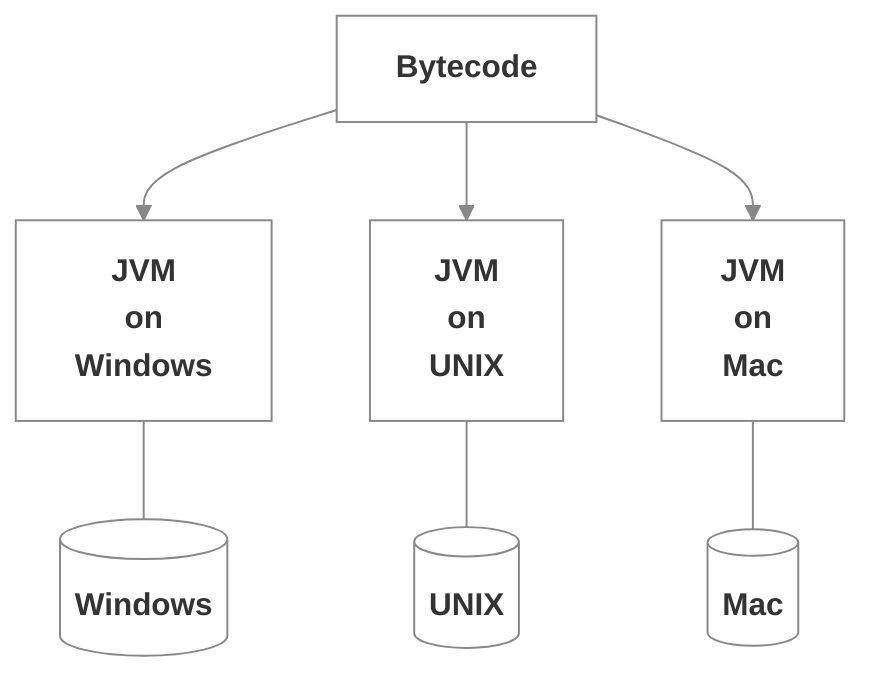

- A bit slower than C/C++ but faster than other languages
- Many high-quality built-in and third-party libraries
- Object-oriented
- Multi-threaded

## First Java app

```java
// File: HelloWorld.java

public class HelloWorld {
    public static void main(String[] args) {
        System.out.println("Hello World!");
    }
}
```

- Every Java program must have a **main** method where execution starts
- The **main** method belongs to a class which is written in a .java file
- The file name (excluding the .java suffix) must match the class name

## Primitive data types

Java has two groups of data types:

- **Primitive** data types: boolean, byte, short, int, long, float, double, char
- **Object** (or **reference**) data types: Boolean, Byte, Short, Integer, Long, Float, Double, Character, String, etc.
  - Like pointers in C but dereference operator is not needed

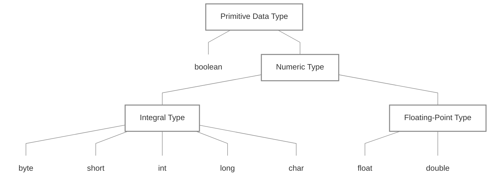

| Type | Size (bits) | Min | Max | Description |
|---|---|---|---|---|
| boolean | 1* | false | true | Store true or false |
| byte | 8 | -2⁷ | 2⁷ - 1 | Store whole numbers in the range |
| short | 16 | -2¹⁵ | 2¹⁵ - 1 | Store whole numbers in the range |
| int | 32 | -2³¹ | 2³¹ - 1 | Store whole numbers in the range |
| long | 64 | -2⁶³ | 2⁶³ - 1 | Store whole numbers in the range |
| char | 16 | 0 | 2¹⁶ - 1 | Store Unicode values in the range |
| float | 32 | -3.4E38 | 3.4E38 | Store fractional numbers in the range up to 6 decimal digits |
| double | 64 | -1.7E308 | 1.7E308 | Store fractional numbers in the range up to 15 decimal digits |

## Variables & constants

Variables are values that may be changed

```java
int i, j;
double interestRate;
boolean isOdd;
```

Variables often have initial values

```java
int i = 1, j = 2;
double interestRate = 0.06;
boolean isOdd = false;
```

Constants are permanent values

```java
final double PI = 3.14159;
```

## Operators

| Level | Category | Operators | Associativity |
|---|---|---|---|
| 1 | Postfix | `()`, `[]`, `.`, `++`, `--` | Left to right |
| 2 | Unary | `+`, `-`, `!`, `~`, `++`, `--`, `(type)` | Right to left |
| 3 | Multiplication | `*`, `/`, `%` | Left to right |
| 4 | Addition | `+`, `-` | Left to right |
| 5 | Comparison | `<`, `<=`, `>`, `>=` | Left to right |
| 6 | Equality | `==`, `!=` | Left to right |
| 7 | Assignment | `=`, `+=`, `-=`, `*=`, `/=`, `%=` | Right to left |
| 8 | Logical | `&&`, `\|\|`, `!` | Left to right |

## Java Naming Convention

| Type | Naming Convention | Example |
|---|---|---|
| Variable | lowerCamelCase format<br>Start with a letter, $ or _ | `int id; double tableWidth;` |
| Constant | All uppercase letters | `final double MIN_WIDTH = 0.9;` |
| Method | lowerCamelCase format<br>Often start with a verb | `void shuffleCards()`<br>`int size()` |
| Class, File & Interface | UpperCamelCase format<br>Often start with a noun | `class CardGame`<br>`CardGame.java`<br>`interface RasterDelegate` |
| Package | All lowercase letters | `com.oracle.eng`<br>`java.sql`<br>`vn.edu.rmit.inte2512.utilities` |

## Statements

A statement specifies an action in a program. There are 4 types of statements:

- Declaration: to declare variables and constants

  ```java
  int count;
  ```

- Assignment: to assign a value to a variable or constant

  ```java
  count = 0;
  ```

- Method invocation: to call a method

  ```java
  System.out.println("Hello World!");
  ```

- Control: to change the execution order of statements

## Comments

- `//` This is a single-line comment
- `/*` This is a multi-line comment `*/`
- `/**` This is a javadoc style comment that can be gathered by java tools to generate documentation `*/`

```java
// This is a single-line comment

/*
  This
  is
  a multi-line comment
 */

/** This is a javadoc style comment
    that can be gathered by java tools
    to generate documentation
*/
```

## Basic I/O

### Output to console

```java
System.out.println("A string to be displayed");
System.out.print("Another string to be displayed");

final double PI = 3.14159;
double radius = 2.5;
System.out.printf("Area of a circle with radius %.2f is %.2f\n", radius, PI * radius * radius );
```

Frequently used format specifiers

| Format Specifier | Output | Example |
|---|---|---|
| %b | a Boolean value | true or false |
| %c | a character | 'a' |
| %d | a decimal integer | 200 |
| %f | a floating-point number | 45.56000 |
| %e | a number in standard scientific notation | 4.556000e+01 |
| %s | a string | "Java is cool" |

### Input from console

```java
Scanner scan = new Scanner(System.in);
System.out.print("Please enter something: ");
String word = scan.next();       // scan one token (one word)
String line = scan.nextLine();   // scan one line
```

Assume the user inputs "David    22    1.85" in one line

```java
String name = scan.next();
int age = scan.nextInt();
double height = scan.nextDouble();
```

| Scanner method | Description |
|---|---|
| boolean nextBoolean() | Scans and returns the next token as a **boolean** |
| byte nextByte() | Scans and returns the next token as a **byte** |
| short nextShort() | Scans and returns the next token as a **short** |
| int nextInt() | Scans and returns the next token as an **int** |
| long nextLong() | Scans and returns the next token as a **long** |
| float nextFloat() | Scans and returns the next token as a **float** |
| double nextDouble() | Scans and returns the next token as a **double** |
| String next() | Scans and returns the next token as a **String** |
| String next(String pattern) | Scans and returns the next token as a **String** if it matches the pattern |
| nextLine() | Scans and returns the current line as a **String** |

## Selections

### if-else statement

```java
boolean isRaining = true;
if (isRaining) { // if (boolean expression is true)
    System.out.println("Bring your umbrella");
} else {
    System.out.println("Bring your hat");
}
```

### chaining if-else statements

```java
if (score >= 80) {
    System.out.println("HD");
} else if (score >= 70) {
    System.out.println("DI");
} else if (score >= 60) {
    System.out.println("CR");
} else if (score >= 70) {
    System.out.println("CR");
} else {
    System.out.printn("NN");
}
```

### ternary operator

```java
if (isMale) {
    title = "Mr";
} else {
    title = "Ms";
}
```

can be written using the ternary operator as:

```java
title = isMale ? "Mr" : "Ms";
```

### switch statement

```java
int num = 2;          // switch expression value can be byte, short
switch (num) {        // int, char, and even String
    case 1:           // case value must be a constant
        System.out.println("One");
        break;
    case 2:
        System.out.println("Two");
        break;
    default:
        System.out.println("Invalid");
}
```

## Loops

### for statement

```java
int sum = 0;
for (int i = 0; i < 10; i++) {
    sum += i;
}
System.out.println(sum);
```

### for-each statement

```java
String[] names = {"Alice", "Bob", "Carol"};
for (String name : names) {
    System.out.println("Hello " + name);
}
```

- for-each statement can also be used with Java collections in addition to arrays

### while statement

```java
int i = 1;
while (i < 10) {
    System.out.println(i);
    i++;
}
```

### do-while statement

```java
int i = 1;
do {
    System.out.println(i);
    i++;
} while (i < 10);
```

## Strings

- A string is simply an array of characters
- Java provides the String class (**object** data type) and several methods to allow working with strings conveniently

Create strings

```java
String greeting = new String("Hello");
String greeting = "Hello";
```

String length

```java
System.out.println(greeting.length());
```

String comparison

```java
System.out.println(greeting.equals("hello"));
```

String concatenation

```java
String firstName = "John"; String lastName  = "Doe";
String fullName  = firstName + " " + lastName;
System.out.println(fullName);
```

Substring

```java
String txt = "RMIT University Vietnam";
System.out.println(txt.substring(5, 8));
```

Searching in a string

```java
System.out.println(txt.indexOf("Viet"));
System.out.println(txt.indexOf("Hello"));
```

| Method | Description |
|---|---|
| int length() | Returns the number of character in this string |
| boolean isEmpty() | Returns true if, and only if, length() is 0 |
| boolean equals(String str) | Returns true if this string is equal to str |
| boolean equalsIgnoreCase(String str) | Returns true if this string is equal to str, ignoring case differences |
| int compareTo(String str) | Compares two strings lexicographically |
| int compareToIgnoreCase(String str) | Compares two strings lexicographically, ignore case differences |
| char charAt(int index) | Returns the character at the given index |
| int codePointAt(int index) | Returns the Unicode code point of the character at the given index |
| String concat(String str) | Returns a new string that concatenates this string with str |
| String toUpperCase() | Returns a new string with all letters in uppercase |
| String toLowerCase() | Returns a new string with all letters in lowercase |
| String substring(int beginIndex, int endIndex) | Returns a new string that is a substring of this string |

| Method | Description |
|---|---|
| boolean startsWith(String str) | Returns true if this string starts with str |
| boolean endsWith(String str) | Returns true if this string ends with str |
| boolean contains(String str) | Returns true if this string contains str |
| int indexOf(String str) | Returns the index of the first occurrence of str in this string , or -1 if there is no such occurrence |
| int lastIndexOf(String str) | Returns the index of the last occurrence of str in this string , or -1 if there is no such occurrence |
| String replace(char oldChar, char newChar) | Returns a new string resulting from replacing all occurrences of oldChar in this string by newChar |
| String replaceAll(String regex, String replacement) | Replaces each substring in this string that matches the given regex with the given replacement |
| String[] split(String regex) | Splits this string around matches of the given regex |
| boolean matches(String regex) | Returns true if this string matches the given regex |

Conversion between strings and numbers

```java
String intString = "123";
int intValue = Integer.parseInt(intString);
String doubleString = "3.14159";
double doubleValue = Double.parseDouble(doubleString);
```

- In Java, strings are **immutable** – they can't be changed after created
- The following code creates a new string and assigns it back to the original variable:

```java
String greeting = "Hello";
greeting += " World";
```

- More details can be found in the String API

## Regular Expressions

- A regular expression (regex) is a string that describes a pattern in a sequence of characters
- Regex can be used for matching, replacing, and splitting strings

```java
String s1 = "Java is fun";
String s2 = "Java is cool";
String regex = "Java.*";
System.out.println(s1.matches(regex));
System.out.println(s2.matches(regex));
```

| Regular expression | Matches |
|---|---|
| `x` | a specified character x |
| `.` | any single character |
| `(ab\|cd)` | ab or cd |
| `[abc]` | a, b, or c |
| `[^abc]` | any character except a, b, or c |
| `[a-z]` | any character from a through z |
| `[^a-z]` | any character except a through z |
| `[a-e[m-p]]` | a through e or m through p |
| `[a-e&&[c-p]]` | intersection of a-e with c-p |
| `\d` | a digit, same as [0-9] |
| `\D` | a non-digit |

| Regular expression | Matches |
|---|---|
| `\w` | a word character, same as [a-zA-Z0-9_] |
| `\W` | a non-word character, same as [^a-zA-Z0-9_] |
| `\s` | a whitespace character |
| `\S` | a non-whitespace character |
| `p*` | zero or more occurrences of pattern p |
| `p+` | one or more occurrences of pattern p |
| `p?` | zero or one occurrence of pattern p |
| `p{n}` | exactly n occurrences of pattern p |
| `p{n, }` | at least n occurrences of pattern p |
| `p{n, m}` | between n and m occurrences of pattern p (inclusive) |
| `^` | beginning of a line |
| `$` | end of a line |

### Quiz

- What is the regular expression of an even integer?

  Answer: `(\d)*[02468]`

- The Social Security Number (SSN) in the US has the format xxx-xx-xxxx, where x is a digit. What is the regular expression for SSN?

  Answer: `\d{3}-\d{2}-\d{4}`

## Arrays

- An array is a **fixed-size order** collection of items of the same data type

Create arrays

```java
int[] nums;            // declare an array
nums = new int[4];     // specify array length(size)
String[] cars = new String[4]; // combine in one statement
```

Create and initialize arrays

```java
int[] nums = {5, 10, 15, 20};
String[] cars = {"Honda", "Toyota", "Ford", "BMW"};
```

Access and update an item

```java
String[] cars = {"Honda", "Toyota", "Ford", "BMW"};
System.out.println(cars[2]);
cars[2] = "Kia";
System.out.println(cars[2]);
```

Loop through an array using a for statement and array indexes

```java
for (int i = 0; i < cars.length; i++) {
    System.out.println(cars[i]);
}
```

Loop through an array using a for-each statement

```java
String[] cars = {"Honda", "Toyota", "Ford", "BMW"};
for (String car : cars) {
    System.out.println(car);
}
```

### Multidimensional Arrays

Create a multidimensional array

```java
int[][] chessCells = new int[8][8];
```

Create and initialize a multidimensional array

```java
int[][] myNumbers = { {1, 2, 3, 4}, {5, 6, 7} };
```

Access multidimensional array items

```java
for (int i = 0; i < myNumbers.length; i++) {
    for (int j = 0; j < myNumbers[i].length; j++) {
        System.out.print(myNumbers[i][j] + " ");
    }
    System.out.println();
}
```

## Further Reading

- [W3Schools: Java Tutorial (Java HOME to Java Scope)](https://www.w3schools.com/java/default.asp)
- [IntelliJ IDEA User Guide](https://www.jetbrains.com/help/idea/discover-intellij-idea.html)
- [Intro to Java Programming (chapters 1-8)](https://search.ebscohost.com/login.aspx?direct=true&AuthType=shib&db=nlebk&AN=1419283&site=ehost-live&custid=s5445732&ebv=EB&ppid=pp_5)
- [Code Conventions for the Java Programming Language](https://www.oracle.com/java/technologies/javase/codeconventions-introduction.html)
- [Javadoc (Wikipedia)](https://en.wikipedia.org/wiki/Javadoc)
