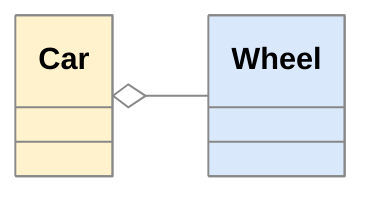
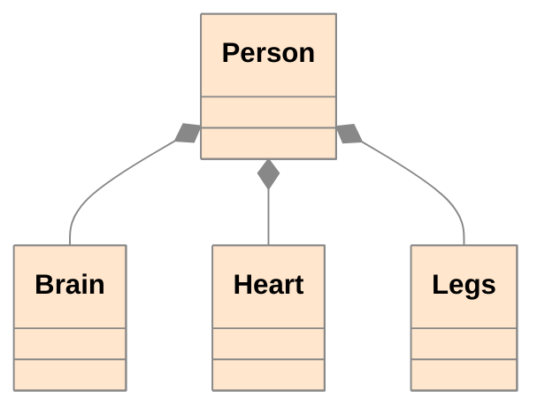
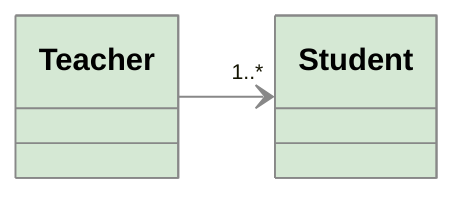
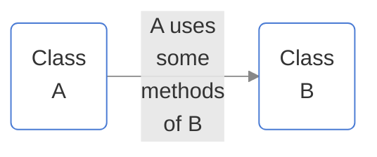
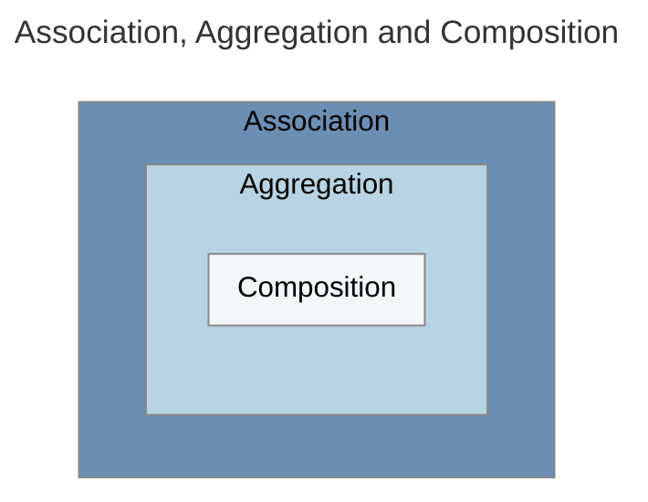
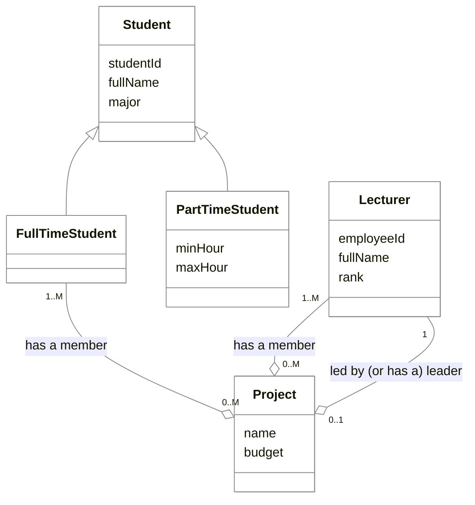
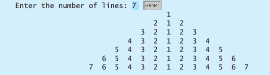
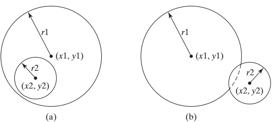

# COSC2731 - Tutorial 1

## Outline

1. Problem 1
2. Problem 2
3. Problem 3
4. Problem 4
5. Extra (Java)

## Problem 1 – UML tools

Let's get familiar with some basic UML class diagram notations (see Further Reading: UML class diagram cheatsheet).

If you draw UML diagrams on a computer, you can use some websites suggested below (see Further Reading: diagrams.net, Figma, Lucidchart). Of course, it's up to you to decide what tools you/your team will use in this course.

### Aggregation vs. Composition

- **Aggregation**: in a *part-of relationship*, the child *can* exist independently of the parent



- **Composition**: in a *part-of relationship*, the child *cannot* exist independent of the parent



### Association and Dependency

- **Association**: one class has another as an attribute



- **Dependency**: a class uses another by parameter or return type





## Problem 2 – Draw UML diagram

Identify the classes and their relationships for the following imaginative scenario:

RMIT University has two types of students: full-time and part-time. All students have student id, full name, and major. Only full-time students can optionally join one research project. Part-time students must register the minimum and maximum hours they spend on instructor-led learning.

Besides students, there are lecturers, who are responsible for teaching and research. Each lecturer has an employee id, full name, and rank. Each lecturer can lead at most one research project at a time, but she/he can join many projects at the same time.

Each research project has a name, a budget, one leader (who must be a lecturer), and one or more members (each can be a full-time student or a lecturer).

Let's take 10 mins for drawing your UML diagram

## Problem 2 - Discussion


**Note:** There is an issue with "has a member" relationship: based on the diagram, it means "each project has at least one lecturer and at least one full-time student", which was not stated in the problem. We can create a common "parent" for lecturer and full-time student to solve this problem (not now).

> Does the diagram say about "**A project has one or more members (each can be a full-time student or a lecturer)**"? How?

## Problem 3 – Implement Student class

Implement the class Student in Java. Decide the appropriate access modifiers for the attributes.

Implement a class StudentTest in the same package as the Student class. In StudentTest, use the main() method to instantiate Student objects and access/modify their attributes.

Create a class StudentTest2 in a different package. Create Student objects and access/modify their attributes from this class.

How to create and run a Java project on IntelliJ [(YouTube)](https://www.youtube.com/watch?v=Y95E0W5wfFE)

## Problem 4 – Implement Project and Lecturer class

Implement two classes Project and Lecturer according to the above specifications. In Lecturer's class, implement two methods:

```java
boolean leadProject(Project p)

boolean joinProject(Project p)
```

leadProject() returns true if the current Lecturer object can lead the project specified in the parameter. Otherwise, it returns false (remember, a lecturer can lead at most one project at a time).

On the other hand, it is always possible for a lecturer to join a project unless other requirements are designed.

In the Project class, implement a method:

```java
void displayMembers()
```

that prints out all members of the current project (including its leader and regular members).

Use Javadoc for the comments.

## Problem 4 - Discussion

> Use Problem 2 diagram to discuss the following questions:

- How should we implement "**has a leader**" relationship between Lecturer and Project?
- How should we implement "**has a member**" relationship between Lecturer and Project?

## Extra (Java)

### Lab - Introduction (1): Introduction to Java (1)

1. Write a program that get three integers from the user and then prints them out in ascending order.

2. Write a program that repeatedly prompts the user to enter a positive integer and checks whether the number is divisible by **both 5 and 6**, or **neither** of them, or **just one** of them. The program ends when the user enters a negative integer or zero.

   Sample run:

   ```text
   Enter a positive integer: 10
   10 is divisible by 5 or 6, but not both
   Enter a positive integer: 30
   30 is divisible by both 5 and 6
   Enter a positive integer: 23
   23 is neither divisible by 5 nor 6
   Enter a positive integer: -1
   Goodbye!
   ```

3. Write a program that displays all the numbers from 100 to 200, ten numbers per line, that are divisible by 5 or 6, but not both. Numbers are separated by exactly one space.

4. Write a program that uses a suitable loop to display a conversion table nicely as the one below, knowing that 1 mile is 1.609 kilometers. *Hint: use System.out.printf().*

   ```text
   Miles   Kilometers  |   Kilometers     Miles
       1         1.61  |           20     12.43
       2         3.22  |           25     15.54
       3         4.83  |           30     18.65
       4         6.44  |           35     21.75
       5         8.05  |           40     24.86
       6         9.65  |           45     27.97
       7        11.26  |           50     31.08
       8        12.87  |           55     34.18
       9        14.48  |           60     37.29
      10        16.09  |           65     40.40
   ```

5. Write a program that prompts the user to enter an integer from 1 to 15 and displays a pyramid, as shown in the following sample run:

   

6. Write a program that prompts the user to enter the center coordinates and radiuses of two circles and determines whether the second circle is inside the first or overlaps with the first, as shown in the below Figure.

   *Hint: circle2 is **inside** circle1 if the distance between the two centers <= |r1 - r2| and circle2 **overlaps** circle1 if the distance between the two centers <= r1 + r2*
   *Test your program to cover all cases.*

   

   (a) A circle is inside another circle. (b) A circle overlaps another circle.

   Sample run:

   ```text
   Enter circle1's center x-, y-coordinates, and radius: 0.5 5.1 13
   Enter circle2's center x-, y-coordinates, and radius: 1 1.7 4.5
   circle2 is inside circle1
   ```

### Lab - Introduction (2): Lab – Introduction to Java (2)

1. Write a program that prompts the user to enter a year and a string of three characters for a month name (with the first letter in uppercase) then displays the number of days in the month. If the user enters an invalid value for year or month, print out a helpful error message. Sample run:

   ```text
   Enter a year: 2001
   Enter a month: Jan
   Jan 2001 has 31 days
   ```

2. Write a program that prompts the user to enter three cities and display them in ascending order. Sample run:

   ```text
   Enter the first city: Chicago
   Enter the second city: Los Angeles
   Enter the third city: Atlanta
   The three cities in alphabetical order are Atlanta Chicago Los Angeles
   ```

3. Write a method that takes a string and returns its reverse. For example, if the given string is "Good day" then the method returns "yad dooG".

4. A palindrome is a string that reads the same backward as forward when ignoring punctuations (see Further Reading: ASCII table), blanks and case difference. For example, "madam", "Hannah", "Step on no pets", "Was it a car or a cat I saw?", "A man, a plan, a canal, Panama!" are all palindromes. Write a method that checks if a given string is a palindrome or not. Hint: use the method in the last exercise.

5. Write a program that determines if a list is already sorted in increasing order. The program should prompt the user to enter a list and displays whether the list is sorted in ascending order or not. Note that the first number in the input indicates the number of elements in the list. The program exits when the first number is 0. Sample run:

   ```text
   Enter list: 10 1 1 3 4 4 5 7 9 11 21
   The list is already sorted
   Enter list: 8 10 1 5 16 61 9 11 1
   The list is not sorted
   ```

6. Write a program that generates 100 random integers between 0 and 9 then displays the count for each number. Hint: use the method Math.random() (see Further Reading: Java Math class).

7. Write a program that reads an unspecified number of scores in one input and determines how many scores are above or equal to the average and how many scores are below the average.

8. Write a program that reads in ten integers between 1 and 100 then displays the number of distinct integers and the distinct integers separated by exactly one space (i.e., if a number appears multiple times, it is displayed only once). Here is the sample run of the program:

   ```text
   Enter ten numbers: 1 2 3 2 1 6 3 4 5 2
   The number of distinct number is 6
   The distinct numbers are: 1 2 3 6 4 5
   ```

9. Write a program that reads a list of integers between 1 and 100 then counts the occurrences of each. Assume that the user always input value integers and the input always ends with 0. Sample run:

   ```text
   Enter the integers between 1 and 100: 2 5 6 5 4 3 23 43 2 0
   2 occurs 2 times
   3 occurs 1 time
   4 occurs 1 time
   5 occurs 2 times
   6 occurs 1 time
   23 occurs 1 time
   43 occurs 1 time
   ```

   Note that if a number occurs more than one time, the plural word "times" is used in the output.

## Learning at home

- Review lectures
- Finish this week tutorial and extra exercises
- Optional: Solve some easy/medium problems at LeetCode (see Further Reading)

## Further Reading

- [UML class diagram cheatsheet](https://jairanjankumar.gitbook.io/cheatsheet/uml-class-diagram)
- [diagrams.net](https://app.diagrams.net/)
- [Figma](https://www.figma.com/)
- [Lucidchart](https://www.lucidchart.com/pages)
- [UML association vs aggregation vs composition (javatpoint)](https://www.javatpoint.com/uml-association-vs-aggregation-vs-composition)
- [How to create and run a Java project on IntelliJ (YouTube)](https://www.youtube.com/watch?v=Y95E0W5wfFE)
- [LeetCode problem set](https://leetcode.com/problemset/all/)
- [ASCII table (punctuation characters)](https://www.kerryr.net/pioneers/ascii3.htm)
- [Java Math class API (Math.random())](https://docs.oracle.com/en/java/javase/11/docs/api/java.base/java/lang/Math.html)
