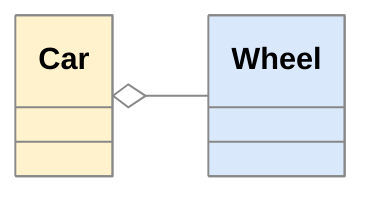
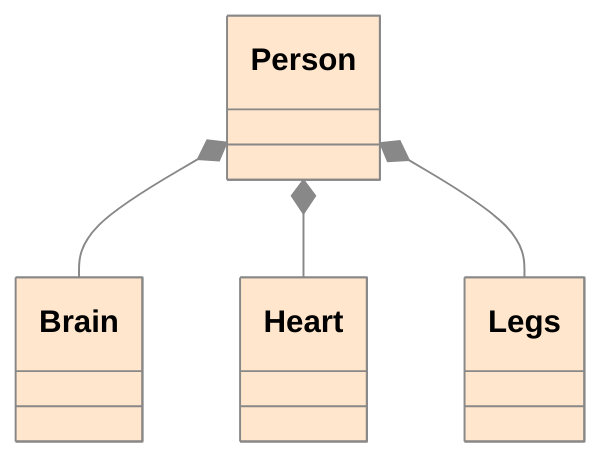
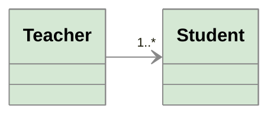
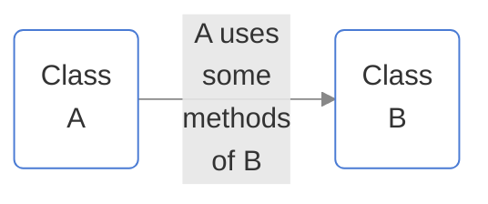
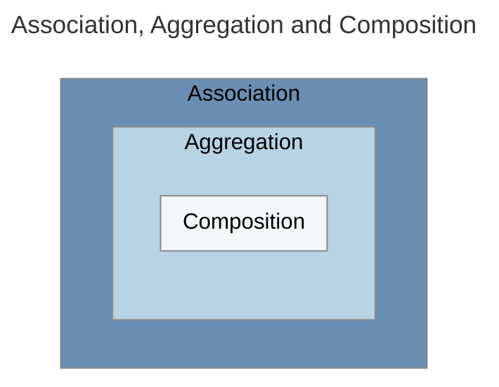
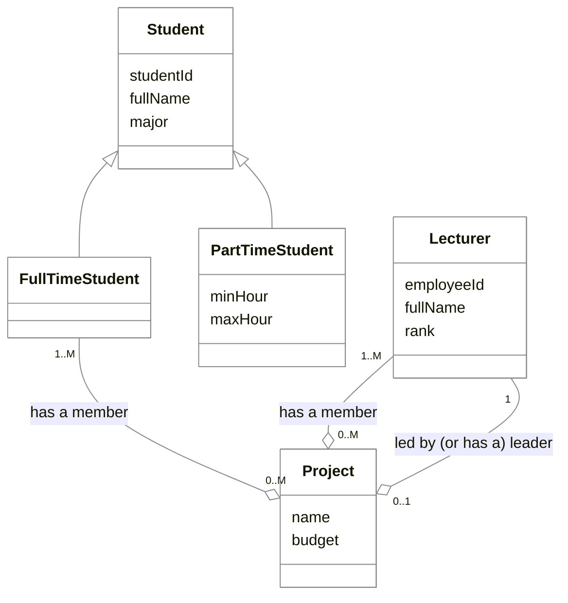

# COSC2731 - Tutorial 1

## Outline

1. Warm greeting
2. Question 1
3. Question 2
4. Question 3
5. Question 4

## Question 1 – UML tools

- Let's get familiar with some basic UML class diagram notations (UML class diagram cheatsheet)
- If you draw UML diagrams on a computer, you can use Lucidchart

### Aggregation vs. Composition

- **Aggregation**: in a *part-of relationship*, the child *can* exist independently of the parent

- **Composition**: in a *part-of relationship*, the child *cannot* exist independent of the parent

### Association and Dependency

- **Association**: one class has another as an attribute

- **Dependency**: a class uses another by parameter or return type

## Question 2 – Draw UML diagram

- RMIT University has two types of **students**: **full-time** and **part-time**. All students have student id, full name, and major. Moreover,
  - Only full-time students can optionally join research projects.
  - Part-time students must register the minimum and maximum hours they spend on instructor-led learning.
- There are **lecturers**, who are responsible for teaching and research. Each lecturer has an employee id, full name, and rank. Each lecturer can lead at most one research project at a time, but she/he can join many projects at the same time.
- Each research **project** has a name, a budget, one leader (who must be a lecturer), and one or more members (each can be a full-time student or a lecturer).

Let's take 10 mins for drawing your UML diagram

## Question 2 - Discussion

**Note:** There is an issue with "has a member" relationship: based on the diagram, it means "each project has at least one lecturer and at least one full-time student", which was not stated in the problem. We can create a common "parent" for lecturer and full-time student to solve this problem (not now).

> Does the diagram say about "**A project has one or more members (each can be a full-time student or a lecturer)**"? How?

## Question 3 – Implement Student class

- Implement the class **Student**. Decide the appropriate access modifiers for the attributes.
- Implement a class **StudentTest** in the **same package** as the Student class. In StudentTest, use the main() method to instantiate Student objects and access/modify their attributes.
- Create a class **StudentTest2** in a **different package**. Create Student objects and access/modify their attributes from this class.
- How to create and run a Java project on IntelliJ [(YouTube)](https://www.youtube.com/watch?v=Y95E0W5wfFE)

## Question 4 – Implement Project and Lecturer class

- In **Lecturer** class, implement two methods:
  - **boolean leadProject(Project p)**: returns true if the current Lecturer object can lead the project specified in the parameter and return false otherwise.
  - **boolean joinProject(Project p)**
- In **Project** class, implement a method:
  - **void displayMembers()**: prints out all members of the current project (including its leader and regular members).
- Use **Javadoc** for the comments

## Question 4 - Discussion

> Use question 2 diagram to discuss the following questions:

- How should we implement "**has a leader**" relationship between Lecturer and Project?
- How should we implement "**has a member**" relationship between Lecturer and Project?

## Learning at home

- Review lectures
- Finish this week tutorial and extra exercises
- Optional: Solve some easy/medium problems at LeetCode (see Further Reading)

## Further Reading

- [UML class diagram cheatsheet](https://jairanjankumar.gitbook.io/cheatsheet/uml-class-diagram)
- [Lucidchart](https://www.lucidchart.com/pages)
- [UML association vs aggregation vs composition (javatpoint)](https://www.javatpoint.com/uml-association-vs-aggregation-vs-composition)
- [How to create and run a Java project on IntelliJ (YouTube)](https://www.youtube.com/watch?v=Y95E0W5wfFE)
- [LeetCode problem set](https://leetcode.com/problemset/all/)
