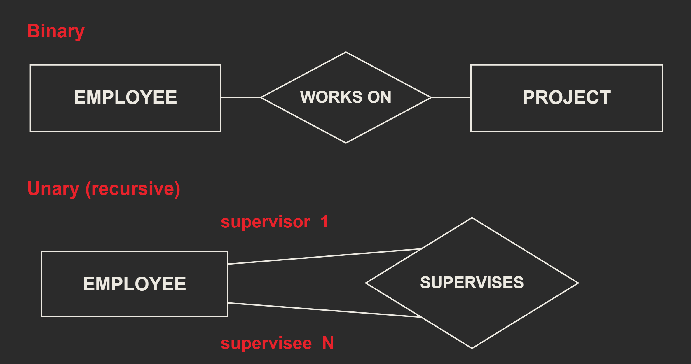
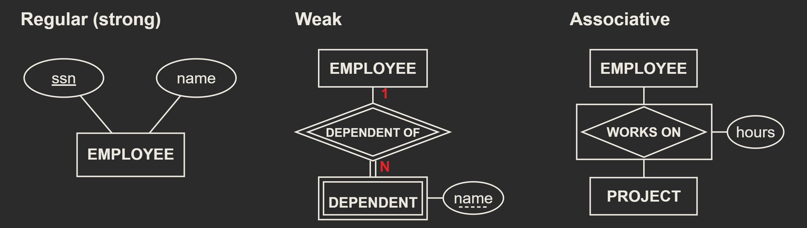
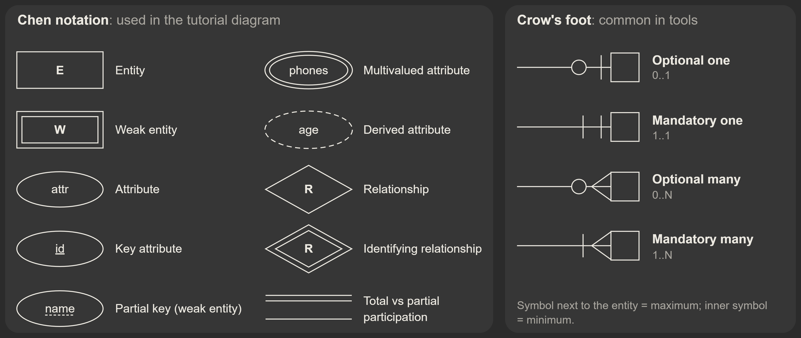
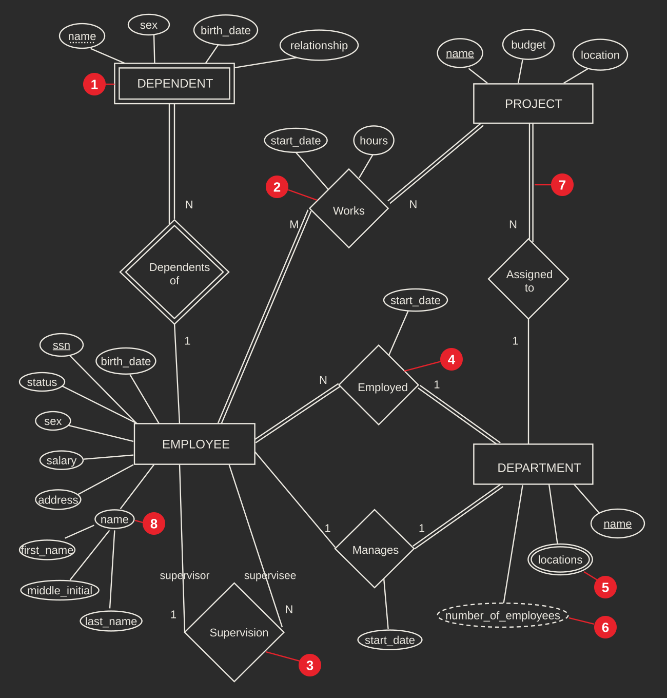
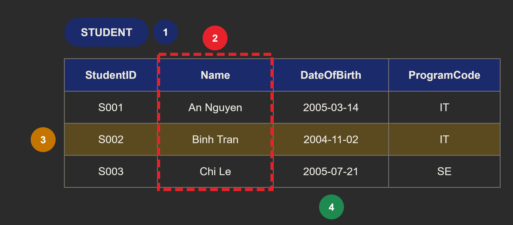
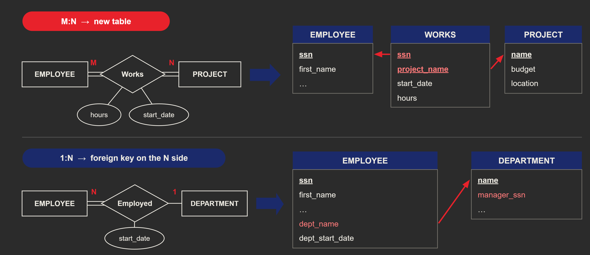
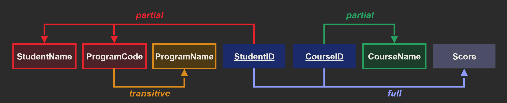
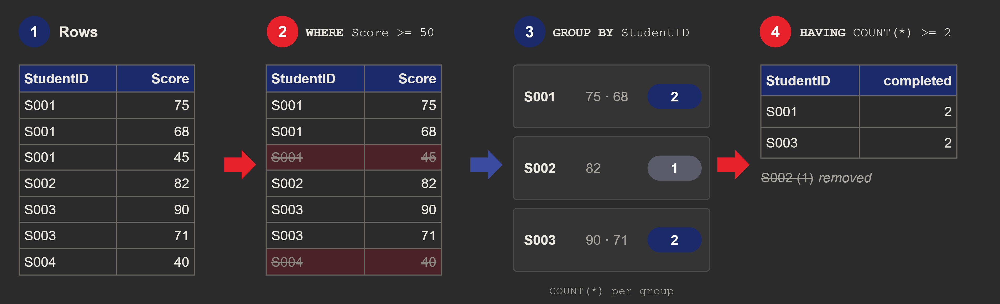

# Data Modeling & ER Diagrams

## From the real world to a running database

| # | Name | Description | Example |
|---|---|---|---|
| 1 | Requirements | What must we store, and for whom? | "A company tracks employees, the departments they work in and the projects they work on." |
| 2 | Conceptual | ER diagram: entities, attributes, relationships | EMP (M) — WORKS — (N) PROJ |
| 3 | Logical | Relational schema: tables, keys, foreign keys (normalized) | EMPLOYEE(ssn, name, dept)<br>WORKS(ssn, project, hours) |
| 4 | Physical | SQL DDL + storage design: indexes, partitions | CREATE TABLE … <br> CREATE INDEX … <br> PARTITION BY … |

## Three building blocks of an ER model

| Block | Definition | Example |
|---|---|---|
| Entity | A real-world object or concept we store data about | Student, Course, Book |
| Attribute | A property or characteristic of an entity | StudentID, Name, DateOfBirth |
| Relationship | A logical association between entities | a Student enrols in a Course |


> Data modeling = defining data elements and their relationships to represent a real-world scenario. The ER (Entity-Relationship) model is our design tool.

## Attribute types

| Type | Rule | Example |
|---|---|---|
| Simple | Cannot be divided further | DateOfBirth |
| Composite | Made of smaller sub-parts | Name = First + Last |
| Derived | Computed from other attributes | Age (from DateOfBirth) |
| Multivalued | Can hold several values | Phone numbers |
| Key | Uniquely identifies each entity | StudentID |

## Relationship cardinality: 1:1, 1:N, M:N

| Cardinality | Name | Example | Explanation |
|---|---|---|---|
| 1:1 | One-to-one | EMPLOYEE (1) — MANAGES — (1) DEPARTMENT | An employee manages at most one department; a department has exactly one manager. |
| 1:N | One-to-many | DEPARTMENT (1) — EMPLOYS — (N) EMPLOYEE | A department employs many employees; each employee works for one department. |
| M:N | Many-to-many | EMPLOYEE (M) — WORKS ON — (N) PROJECT | An employee works on many projects; a project has many employees. |

## Degree and participation

### Degree: how many entity types take part



### Participation: must every entity take part?

| Type | Notation | Example |
|---|---|---|
| Partial | single line | Most employees manage nothing |
| Total | double line | Every department has a manager |


## Entity types: regular, weak, associative

| Type | Description |
|---|---|
| Regular (strong) | Has its own key (ssn) and exists independently of other entities. |
| Weak | No key of its own: identified by its owner's key + a partial key (ssn + name). A dependent only exists for an employee. |
| Associative | Represents an M:N relationship as an entity, so it can carry its own attributes (hours worked). |



## ER notation cheat sheet



## Decode the tutorial's Chen ER diagram

1. **DEPENDENT**: weak entity. Double box; key = employee ssn + partial key name.
2. **Works**: M:N relationship. Has its own attributes (start_date, hours) → own table.
3. **Supervision**: recursive 1:N. One supervisor, many supervisees.
4. **Employed**: 1:N. Each employee works in one department.
5. **locations**: multivalued. Double ellipse → separate table.
6. **number_of_employees**: derived. Dashed ellipse → compute with COUNT, don't store.
7. **Double lines**: total participation. e.g. every project is assigned to a department.
8. **name**: composite. first_name, middle_initial, last_name.



# Relational Model & Normalization

## Anatomy of a relation

A relational database stores data in relations (tables) made of rows and columns.

| # | Term | Meaning |
|---|---|---|
| 1 | Relation | a table with a unique name |
| 2 | Attribute | a column, i.e. a property of the entity |
| 3 | Tuple | a row, i.e. one record |
| 4 | Domain | the set of valid values, e.g. DateOfBirth ∈ valid dates |



```text
Schema: the structure (design time)
STUDENT(StudentID, Name, DateOfBirth, ProgramCode)
Instance: the actual rows at one moment
changes with every INSERT, UPDATE, DELETE
```

## Keys: how rows are identified and linked

| Key | Name | Description |
|---|---|---|
| CK | Candidate key | Any minimal set of attributes that uniquely identifies a row. A table can have several: StudentID, Email. |
| PK | Primary key | The candidate key we choose as the main identifier. Unique and never NULL. |
| FK | Foreign key | References another table's primary key. Links tables and enforces referential integrity. |


## ER → relational: six mapping rules

| # | Element | Rule |
|---|---|---|
| 1 | Regular entity | Create a table with its attributes. The key becomes the primary key. |
| 2 | Weak entity | Table with its attributes + an FK to the owner. PK = (owner key, partial key). |
| 3 | 1:1 or 1:N | No new table: add an FK on the "many" side (for 1:1, on the total-participation side). |
| 4 | M:N relationship | New table with FKs to both entities (together the PK) + the relationship's attributes. |
| 5 | Multivalued attribute | New table: (entity key, value); both columns form the PK. |
| 6 | Derived attribute | Usually not stored. Compute it in a query when needed. |

## Mapping in action: Works and Employed

- M:N → new table (Works)
- 1:N → foreign key on the N side (Employed)



# Normalization

## Why normalize? Spot the anomalies

Normalization organizes data to minimize redundancy and protect data integrity.

| StudentID | StudentName | Prog | ProgramName | CourseID | CourseName | Score |
|---|---|---|---|---|---|---|
| S001 | An Nguyen | IT | Information Technology | ISYS2099 | Database Applications | 75 |
| S001 | An Nguyen | IT | Information Technology | COSC2469 | Algorithms & Analysis | 68 |
| S002 | Binh Tran | IT | Information Technology | ISYS2099 | Database Applications | 82 |
| S003 | Chi Le | SE | Software Engineering | ISYS2099 | Database Applications | 90 |

Same fact stored again and again = redundancy.

Why two key columns? One row = one student in one course. StudentID repeats (S001). CourseID repeats (ISYS2099). Only the pair is unique.

| Anomaly | Description |
|---|---|
| Insertion anomaly | Can't add a new course (e.g. ISYS3434) until a student enrols: StudentID is part of the key, so it can't be NULL. |
| Update anomaly | Rename "Database Applications" → update every row. Miss one = inconsistent data. |
| Deletion anomaly | Delete S003's only enrolment → we also lose that SE = Software Engineering. |

## What is normalization? 1NF, 2NF, 3NF

Normalization = splitting a table into smaller tables so that each fact is stored once.

Why: a fact stored once can't repeat or contradict itself, so the three anomalies go away.

| Form | Nickname | Rule | Why | Example |
|---|---|---|---|---|
| 1NF | One value per cell | Every cell holds one value. No lists or repeating groups. | A value hidden in a list can't be searched, counted or checked. | A student's list of courses becomes one row per course. |
| 2NF | The whole key | 1NF + every non-key attribute depends on the whole key. | Facts that need only part of the key repeat in every row. | StudentName needs only StudentID, so it moves to STUDENT. |
| 3NF | Nothing but the key | 2NF + non-key attributes don't depend on each other. | Facts about something else repeat in many rows. | ProgramName depends on ProgramCode, so it moves to PROGRAM. |

## Functional dependencies

**X → Y** · "X determines Y": if two rows agree on X, they must agree on Y. e.g. CourseID → CourseName



| Dependency | Description |
|---|---|
| Full dependency | on the whole key: (StudentID, CourseID) → Score ✔ |
| Partial dependency | on part of a composite key - ✘ violates 2NF |
| Transitive dependency | on a non-key attribute - ✘ violates 3NF |

## Step 1 → 1NF: make every value atomic

### Before · UNF

| StudentID | StudentName | Prog | ProgramName | Courses (CourseID · CourseName · Score) |
|---|---|---|---|---|
| S001 | An Nguyen | IT | Information Technology | ISYS2099 · Database Applications · 75<br/>COSC2469 · Algorithms & Analysis · 68 |
| S002 | Binh Tran | IT | Information Technology | ISYS2099 · Database Applications · 82 |
| S003 | Chi Le | SE | Software Engineering | ISYS2099 · Database Applications · 90 |

**Split the list**: one row per student per course

### After · 1NF

| StudentID | StudentName | Prog | ProgramName | CourseID | CourseName | Score |
|---|---|---|---|---|---|---|
| S001 | An Nguyen | IT | Information Technology | ISYS2099 | Database Applications | 75 |
| S001 | An Nguyen | IT | Information Technology | COSC2469 | Algorithms & Analysis | 68 |
| S002 | Binh Tran | IT | Information Technology | ISYS2099 | Database Applications | 82 |
| S003 | Chi Le | SE | Software Engineering | ISYS2099 | Database Applications | 90 |

1NF rule: every cell holds one atomic value: no lists, no repeating groups. New key: (StudentID, CourseID)

## Step 2 → 2NF: remove partial dependencies

StudentName, ProgramCode, ProgramName depend only on StudentID; CourseName only on CourseID → split by determinant

**STUDENT**

| StudentID | StudentName | Prog | ProgramName |
|---|---|---|---|
| S001 | An Nguyen | IT | Information Technology |
| S002 | Binh Tran | IT | Information Technology |
| S003 | Chi Le | SE | Software Engineering |

**COURSE**

| CourseID | CourseName |
|---|---|
| ISYS2099 | Database Applications |
| COSC2469 | Algorithms & Analysis |

**ENROLLMENT**

| StudentID | CourseID | Score |
|---|---|---|
| S001 | ISYS2099 | 75 |
| S001 | COSC2469 | 68 |
| S002 | ISYS2099 | 82 |
| S003 | ISYS2099 | 90 |

2NF = 1NF + every non-key attribute depends on the whole key. (Only a composite key can break it.)

Still repeated: "Information Technology" → 3NF

## Step 3 → 3NF: remove transitive dependencies

ProgramName depends on the key only through ProgramCode

StudentID → ProgramCode → ProgramName

### STUDENT (2NF)

| StudentID | StudentName | Prog | ProgramName |
|---|---|---|---|
| S001 | An Nguyen | IT | Information Technology |
| S002 | Binh Tran | IT | Information Technology |
| S003 | Chi Le | SE | Software Engineering |

### After 3NF:

STUDENT

| StudentID | StudentName | Prog |
|---|---|---|
| S001 | An Nguyen | IT |
| S002 | Binh Tran | IT |
| S003 | Chi Le | SE |

PROGRAM

| Prog | ProgramName |
|---|---|
| IT | Information Technology |
| SE | Software Engineering |

Prog (ProgramCode) in STUDENT is now a foreign key → PROGRAM

Final 3NF schema: 4 tables

```text
STUDENT(StudentID, StudentName, ProgramCode)
PROGRAM(ProgramCode, ProgramName)
COURSE(CourseID, CourseName)
ENROLLMENT(StudentID, CourseID, Score)
```

3NF = 2NF + no transitive dependencies: non-key attributes depend on nothing but the key.

## The normalization staircase

> Every non-key attribute must depend on the key, the whole key, and nothing but the key. (After William Kent, 1983)

| Level | Quote | Rule |
|---|---|---|
| UNF | | Lists and repeating groups in cells |
| 1NF | "the key" | Atomic values, one fact per row |
| 2NF | "the whole key" | No partial dependencies |
| 3NF | "nothing but the key" | No transitive dependencies |

## Normalize or denormalize? It's a trade-off

| Normalize when… | Denormalize when… |
|---|---|
| Data consistency is critical | The system is read-heavy |
| You need to eliminate redundancy | Query speed matters more than update speed |
| The system has frequent inserts and updates | Reports and analytics need fewer joins |
| Integrity and a clear logical design matter | Datasets are small and redundancy is cheap |
| You are in the initial design phase | Tables are rarely updated |

Normalized: fewer anomalies, more JOINs · Denormalized: faster reads, copies to sync · Weeks 2 to 4: make it fast

# SQL Review

## SQL in one picture: four command families

| Family | Full name | Purpose | Commands |
|---|---|---|---|
| DDL | Data Definition | Define structure | CREATE · ALTER · DROP |
| DML | Data Manipulation | Work with data | SELECT · INSERT · UPDATE · DELETE |
| DCL | Data Control | Control access | GRANT · REVOKE |
| TCL | Transaction Control | Group changes safely | COMMIT · ROLLBACK |

Syntax basics:

- Statements end with ;
- Keywords are case-insensitive; UPPERCASE by convention
- Text values in single quotes: 'An Nguyen'

Common data types:

| Type | Example |
|---|---|
| INT | 42 |
| DECIMAL(p,s) | 1234.50 |
| VARCHAR(n) | 'IT' |
| BOOLEAN | TRUE |
| DATE | '2026-10-20' |

## CREATE TABLE: turning the schema into SQL

```sql
CREATE TABLE Program (
  ProgramCode VARCHAR(10)    PRIMARY KEY,
  ProgramName VARCHAR(100) NOT NULL
);
CREATE TABLE Student (
  StudentID   VARCHAR(10)    PRIMARY KEY,
  Name        VARCHAR(100) NOT NULL,
  Email       VARCHAR(100) UNIQUE,
  ProgramCode VARCHAR(10),
  FOREIGN KEY (ProgramCode)
    REFERENCES Program(ProgramCode)
);
```

| # | Constraint | Meaning |
|---|---|---|
| 1 | PRIMARY KEY | unique + never NULL: the row's identity |
| 2 | NOT NULL | a value is required |
| 3 | UNIQUE | no duplicates; with NOT NULL it's a candidate key |
| 4 | FOREIGN KEY … REFERENCES | value must exist in Program (referential integrity) |

> Create parent tables first (Program before Student). A foreign key can only reference a table that already exists.

## Change the structure vs change the data

### Change the structure (DDL)

Add a column

```sql
ALTER TABLE Student ADD Phone VARCHAR(20);
```

Drop a column

```sql
ALTER TABLE Student DROP COLUMN Phone;
```

Change a column

```sql
ALTER TABLE Student MODIFY Name VARCHAR(150);
```

### Change the data (DML)

Insert rows

```sql
INSERT INTO Student (StudentID, Name)
VALUES ('S004', 'Dung Pham');
```

Insert the result of a query

```sql
INSERT INTO Student (StudentID, Name)
SELECT ApplicantID, Name FROM Applicant;
```

Update

```sql
UPDATE Student SET Name = 'Bob'
WHERE StudentID = 'S001';
```

Delete

```sql
DELETE FROM Student WHERE StudentID = 'S003';
```

> UPDATE or DELETE without WHERE changes every row. Run the matching SELECT … WHERE first.

## How MySQL reads a SELECT: the logical order

```sql
SELECT     CourseID, AVG(Score) AS avg_score
FROM       Enrollment
WHERE      Score IS NOT NULL
GROUP BY   CourseID
HAVING     COUNT(*) >= 10
ORDER BY   avg_score DESC
LIMIT      3;
```

| Order | Clause | Role |
|---|---|---|
| 1 | FROM / JOIN | pick and combine tables |
| 2 | WHERE | filter rows |
| 3 | GROUP BY | form groups |
| 4 | HAVING | filter groups |
| 5 | SELECT | compute output columns |
| 6 | ORDER BY | sort |
| 7 | LIMIT | keep the first n rows |

**Why it matters**: WHERE runs before GROUP BY and SELECT, so COUNT(*) and the alias avg_score don't exist yet. Filter groups with HAVING.

**Future preview**: the optimizer may run steps in another physical order, but the result must match this logical order.

## Filter, sort and limit

Filter rows (WHERE)

```sql
SELECT StudentID, Name FROM Student;
SELECT * FROM Student
WHERE ProgramCode = 'IT';
SELECT StudentID AS Code,
       Name AS `Friendly Name`
FROM Student;
```

Operators: `=` `!=` `<` `<=` `>` `>=` `AND` `OR` `NOT` `BETWEEN` `IN` `LIKE` `IS NULL` `IS NOT NULL`

NULL = unknown. Write IS NULL, never = NULL (it is never true).

Sort & limit (ORDER BY · LIMIT)

```sql
SELECT * FROM Result ORDER BY Score DESC;
SELECT * FROM Student
ORDER BY ProgramCode ASC, Name ASC;
SELECT * FROM Student ORDER BY StudentID
LIMIT 5 OFFSET 10; -- skip 10, return 5
```

Pagination: page p, n rows per page

```sql
LIMIT n OFFSET (p-1)*n
```

## GROUP BY and HAVING, step by step

1. Rows
2. WHERE Score >= 50
3. GROUP BY StudentID
4. HAVING COUNT(*) >= 2

Rows:

| StudentID | Score |
|---|---|
| S001 | 75 |
| S001 | 68 |
| S001 | 45 |
| S002 | 82 |
| S003 | 90 |
| S003 | 71 |
| S004 | 40 |

After WHERE Score >= 50 (rows with 45 and 40 removed). After GROUP BY StudentID, COUNT(*) per group: S001 (75 · 68) = 2, S002 (82) = 1, S003 (90 · 71) = 2. After HAVING COUNT(*) >= 2:

| StudentID | completed |
|---|---|
| S001 | 2 |
| S003 | 2 |

S002 (1) removed.



```sql
SELECT StudentID, COUNT(*) AS completed
FROM Enrollment
WHERE Score >= 50          -- filters rows
GROUP BY StudentID
HAVING COUNT(*) >= 2;      -- filters groups
```

Aggregates: COUNT · SUM · AVG · MIN · MAX. Every SELECT column must be in GROUP BY or inside an aggregate.

## JOINs: which rows survive?

| Join | Rows returned |
|---|---|
| INNER JOIN | Only rows that match in both tables |
| LEFT JOIN | All rows of A + matches from B (NULL if none) |
| RIGHT JOIN | All rows of B + matches from A (NULL if none) |
| FULL JOIN | All rows of both tables (not built into MySQL) |


```sql
SELECT s.Name AS Student, p.ProgramName
FROM Student s
LEFT JOIN Program p
  ON s.ProgramCode = p.ProgramCode;
-- students with no program still appear
```

MySQL has no FULL OUTER JOIN. Emulate it:

```sql
A LEFT JOIN B
UNION
A RIGHT JOIN B
```

## Self-join: a table joined to itself

Same table, two aliases: Employee e (as employee) and Employee s (as supervisor).


```sql
SELECT e.Name AS employee, s.Name AS supervisor
FROM Employee e
JOIN Employee s ON e.SupervisorID = s.EmpID;
```

Result:

| employee | supervisor |
|---|---|
| Minh | Hoa |
| Lan | Hoa |
| Quang | Minh |

Hoa has no supervisor → dropped by JOIN; use LEFT JOIN to keep her.

Tutorial Q2, Q9 and Q10 pair each employee with their supervisor: a self-join. In the Sample DB: EMPLOYEE.Super_ssn → EMPLOYEE.Ssn.

## Subqueries: a query inside a query

| Type | Description |
|---|---|
| Scalar | one value; compare with =, <, > |
| Row | one row; compare a tuple: (a, b) = (…) |
| Table | many rows; use with IN, EXISTS, or in FROM |

Table subquery with IN

```sql
SELECT Name FROM Student
WHERE StudentID IN (
  SELECT StudentID FROM Enrollment
    WHERE CourseID = 'ISYS2099'
);
```

Row subquery · same department and salary as Minh

```sql
SELECT Name, Salary FROM Employee
WHERE (Dno, Salary) = (
  SELECT Dno, Salary FROM Employee
    WHERE Name = 'Minh'
);
```

Correlated subquery: the inner query uses a column of the outer row, so it is evaluated per outer row. The next three patterns rely on it.

## Challenging Patterns

### Pattern 1: "not in any" (the anti-join)

Which students are not enrolled in any course? (Tutorial Q3, Q5)

Option A · NOT EXISTS

```sql
SELECT s.Name
FROM Student s
WHERE NOT EXISTS (
   SELECT 1 FROM Enrollment e
   WHERE e.StudentID = s.StudentID
);
```

Option B · LEFT JOIN … IS NULL

```sql
SELECT s.Name
FROM Student s
LEFT JOIN Enrollment e
  ON e.StudentID = s.StudentID
WHERE e.StudentID IS NULL;
```

A = Student, B = Enrollment


NOT IN trap: if the subquery returns any NULL, x NOT IN (…) is never true, so you silently get zero rows. Prefer NOT EXISTS.

### Pattern 2: "for all" (relational division)

Which students have taken ALL core courses? (Tutorial Q6, Q12 (*))

Example: core courses are DB, ALG, PRG. An took DB, ALG, PRG, WEB (qualifies). Binh took DB, PRG (missing ALG, does not qualify).


Read it as: there is no core course that the student has not taken.

```sql
SELECT s.Name
FROM Student s
WHERE NOT EXISTS (
  SELECT * FROM Course c
  WHERE c.IsCore = TRUE
    AND NOT EXISTS (
      SELECT * FROM Enrollment e
      WHERE e.StudentID = s.StudentID
        AND e.CourseID = c.CourseID));
```

Alternative · count them

```sql
SELECT e.StudentID
FROM Enrollment e
JOIN Course c ON c.CourseID = e.CourseID
WHERE c.IsCore = TRUE
GROUP BY e.StudentID
HAVING COUNT(*) = (SELECT COUNT(*)
    FROM Course WHERE IsCore = TRUE);
```

### Pattern 3: "the top one per group"

Who scored highest in each course? (Tutorial Q7 (*))


```sql
SELECT e.CourseID, e.StudentID, e.Score
FROM Enrollment e
WHERE e.Score = (
   SELECT MAX(e2.Score)
   FROM Enrollment e2
   WHERE e2.CourseID = e.CourseID
);
```

For each outer row, the inner query finds the top score of that row's course. Ties → all winners are returned.

MySQL 8+ alternative:

```sql
RANK() OVER (PARTITION BY CourseID ORDER BY Score DESC)
```

### Pattern 4: "keep the zeros"

Count each student's courses, including zero (Tutorial Q10, Q11 (*))

✘ Wrong · COUNT(*)

```sql
SELECT s.StudentID,
  COUNT(*) AS courses
FROM Student s
LEFT JOIN Enrollment e
  ON e.StudentID = s.StudentID
GROUP BY s.StudentID; -- gives 1
```

✔ Right · COUNT(e.CourseID)

```sql
SELECT s.StudentID,
  COUNT(e.CourseID) AS courses
FROM Student s
LEFT JOIN Enrollment e
  ON e.StudentID = s.StudentID
GROUP BY s.StudentID; -- gives 0
```

A = Student, B = Enrollment


Two more traps: with a LEFT JOIN, SUM of the missing rows is NULL, not 0, so write COALESCE(SUM(w.Hours), 0). And filter the right-hand table in ON, not WHERE, or the zero rows vanish again.

## Quick check: type 1, 2 or 3 in the chat

| Q | Question | Option 1 | Option 2 | Option 3 |
|---|---|---|---|---|
| Q1 | R(StudentID, CourseID, CourseName, Score), key (StudentID, CourseID). Which normal form does it break first? | 1NF | 2NF | 3NF |
| Q2 | Departments with more than 5 employees: where does COUNT(*) > 5 go? | HAVING | WHERE | ORDER BY |
| Q3 | EMPLOYEE M:N PROJECT, with attribute hours. How many tables after mapping? | 2 | 4 | 3 |

## Tutorial toolkit: which tool for which question?

| Q | What it asks | Tools to reach for |
|---|---|---|
| 1 | Research employees working ≥ 10 h/week on some project | JOIN 3 tables + WHERE |
| 2 | Employees supervised by managers from Research | Self-join or nested IN |
| 3 | Department managers not working on any project | Anti-join · NOT EXISTS (pattern 1) |
| 4 | Each project with total weekly hours | JOIN + GROUP BY + SUM |
| 5 | Employees not on any project in Houston | Anti-join with a condition inside (pattern 1) |
| 6 * | Employees on ALL projects in Houston | Division · double NOT EXISTS or COUNT (pattern 2) |
| 7 * | Highest-paid employee(s) in each department | Top per group · correlated subquery (pattern 3) |
| 8 | Departments with at least 3 employees | GROUP BY + HAVING COUNT(*) |
| 9 | Employees older than their direct supervisor | Self-join + compare birth dates |
| 10 * | Employees on more projects than their direct supervisor | Self-join + counts that keep zeros (pattern 4) |
| 11 * | Per department: weekly hours on other departments' projects | LEFT JOIN + COALESCE(SUM, 0) (pattern 4) |
| 12 * | Employees on every project their own department controls | Division, NOT EXISTS version (pattern 2) |
| Ex 2 | Normalize Order to 1NF, 2NF, 3NF | The three-step recipe from Part 03 |

\* = challenge question · patterns 1 to 4 are on the previous slides

## Tutorial this week: get set up

| Step | Task | Detail |
|---|---|---|
| 1 | Install MySQL | Windows or macOS · Canvas guide, 30–45 min |
| 2 | Load the sample DB | Run company.sql: 6 tables + data |
| 3 | Study the diagram | Use the Sample DB diagram: real tables, keys and column names |
| 4 | Solve | Exercise 1: 12 SQL queries · Exercise 2: normalize Order |

First commands to run

```sql
SHOW TABLES;                          -- what's here?
DESCRIBE <table>;                     -- columns & keys
SELECT * FROM <table> LIMIT 5;        -- peek at data
```

Canvas → W1 - Installing MySQL Server and Workbench: install guide, Sample DB and lab login details.

Work smart:

- Build queries in steps: FROM/JOIN → check rows → WHERE → GROUP BY
- Check results by hand on a few rows
- Workbench: read timeout 600 s, untick Safe Updates
- Stuck? Post in the Week 1 Discussion

## Key takeaways

- ER diagrams capture what to store: entities, attributes, relationships, cardinality, participation
- Six mapping rules turn ER into tables: keys and foreign keys link them together
- Normalize one step at a time: atomic → the whole key → nothing but the key
- Think in SQL's logical order: FROM → WHERE → GROUP BY → HAVING → SELECT → ORDER BY

Next week · W2: Database indexing. Your query is instant on 1,000 rows. What happens at 10 million? Also: how database applications are structured.
