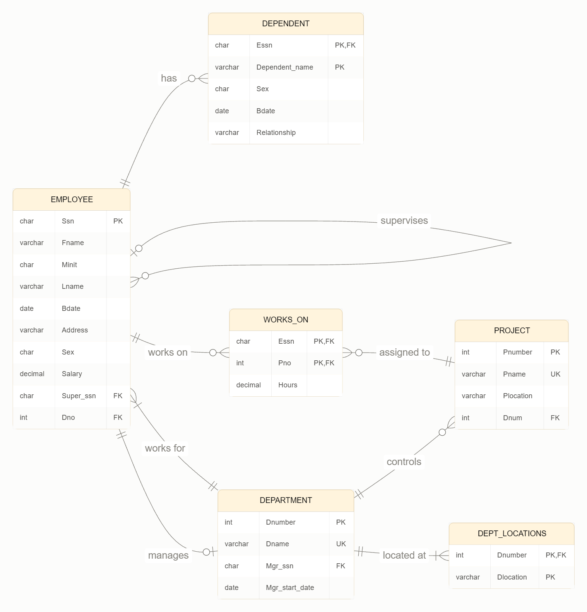
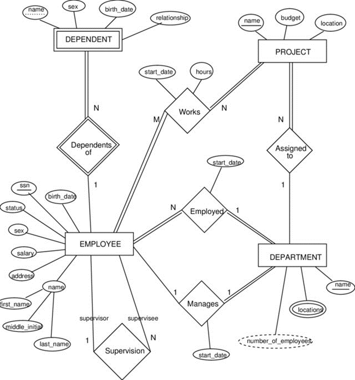

# Week 1 Tutorials

Before starting this tutorial, follow the instructions on **W1 - Installing MySQL Server and Workbench** to install MySQL and load the Week 1 Sample DB. Read the Sample DB SQL before running it.

## Preparation

Try to answer these questions from the Sample DB SQL:

1. What is the difference between a `CREATE TABLE` statement and an `INSERT INTO` statement in this script?
2. What does `PRIMARY KEY (Essn, Pno)` mean for the `WORKS_ON` table? Could the same employee have two rows for the same project?
3. How does `FOREIGN KEY (Pno) REFERENCES PROJECT(Pnumber)` connect `WORKS_ON` to `PROJECT`?
4. Why might `Super_ssn` contain null for James Borg, while `Dno` is declared `NOT NULL`?
5. Which statements create the tables, and which statements add the sample rows?

Check your predictions against the tables and data you loaded.

Study the first ER diagram below, which shows the Sample DB created by the SQL script in step 1. Then compare it with the second, related ER diagram: what entities, attributes and relationships are the same, and what is different? Use the SQL script for the exact tables and columns when writing queries.



Related ER diagram for comparison:



> Note: This diagram is related to the Sample DB but includes attributes not present in the supplied SQL script. Use it for comparison, not as the schema for your queries.

## Getting started

- Compare the diagrams as directed above, and use the tables and column names in the script when writing queries.
- Start with Exercise 0 to warm up your SQL skills, or skip to Exercise 1 if you feel confident.
- For Exercise 1, write a query in your editor, run it, and inspect the results. Start with a simple `SELECT` from a relevant table; then add the joins, conditions or grouping the question requires. Run the query again after each change.

## Exercise 0: Warm Up SQL

Write SQL queries to answer these warm-up questions before moving to Exercise 1. If you are confident in your SQL skills, feel free to skip Exercise 0 and start with Exercise 1.

1. List the first name, last name and salary of every employee. Hint: Select only the columns you need from `EMPLOYEE`.
2. Which employees earn more than 30000? Hint: Use a `WHERE` condition on `Salary`.
3. Who are the three highest-paid employees? Hint: Sort by `Salary` from highest to lowest, then limit the result to three rows.
4. Which employee has no supervisor? Hint: Check which row has `Super_ssn IS NULL`.
5. Which employees live in Houston? Hint: Look for Houston within the employee `Address`.
6. List the different project locations, each one only once. Hint: Use `DISTINCT` with the project location column.
7. For each department number, show how many employees work there and their average salary. Hint: Group employees by `Dno`, then use `COUNT` and `AVG`.
8. List every employee's first and last name with the name of their department. Hint: Join `EMPLOYEE` to `DEPARTMENT` using the employee's department number.

## Exercise 1: SQL

Write SQL queries to answer the following questions. Questions marked (*) are more challenging.

1. Find the names of employees who work in the 'Research' department and participate in at least one project with the number of hours per week greater than or equal to 10.
2. Find the names of employees who are supervised by managers from the 'Research' department. Note: the managers are from the 'Research' department.
3. Find the names of all departments' managers who are not working on any project.
4. For each project, display its name and total working hours per week of all employees participating in that project.
5. Find the names of employees who are not working on any project in 'Houston'.
6. Find the names of employees who are working on all projects in 'Houston'. (*)
7. Find the names of employees who have the highest salaries in each department. (*)
8. Find the names of all departments that have at least 3 employees.
9. Find all employees who are older than their direct supervisors. For each such employee, display his/her name, birthday, supervisor's name, and supervisor's birthday.
10. Find the names of employees who work on more projects than their direct supervisors. Display each employee's name, their supervisor's name, and both project counts. Include employees and supervisors who work on no projects. (*)
11. For each department, display its name and the total weekly hours its employees spend on projects controlled by other departments. Include departments with no such work, showing 0 hours. (*)
12. Find the names of employees who work on every project controlled by their own department. Include employees whose department controls no projects. (*)

## Exercise 2: Normalization

An Order relation is created to store orders for a shop. The structure of the relation is as follows:

```
Order (
  OrderID,
  CustomerID,
  CustomerName,
  CustomerPhone,
  Products,
  OrderDate
)
```

An order must belong to a single customer. There can be multiple products in an order. For this exercise, assume that each product has a unique `ProductID` and a `ProductName`, and that a product can appear in multiple orders. The `Products` field contains a list of the products in that order.

Normalize the Order relation to 1NF, 2NF, and 3NF. At each stage, show the resulting relations, identify their primary keys, and explain which dependency or normalization rule motivates each change. In your final design, identify any foreign keys needed to link orders, customers, and products.
