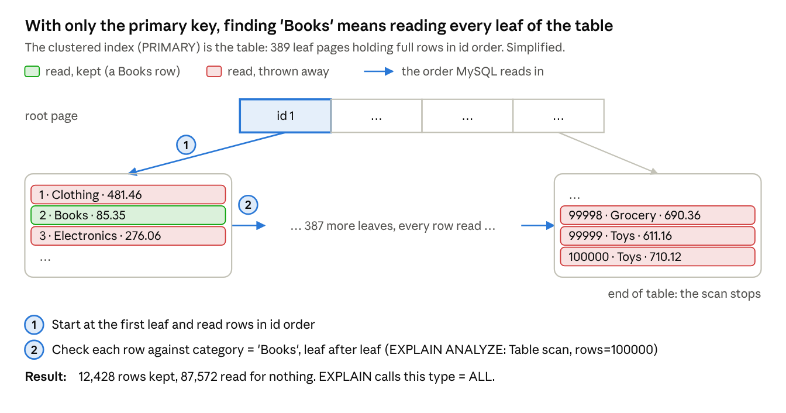
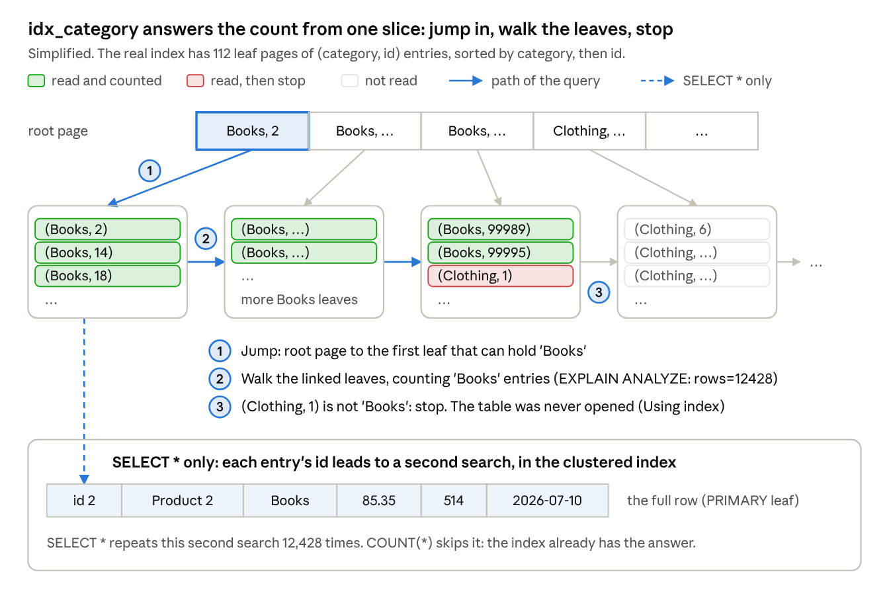
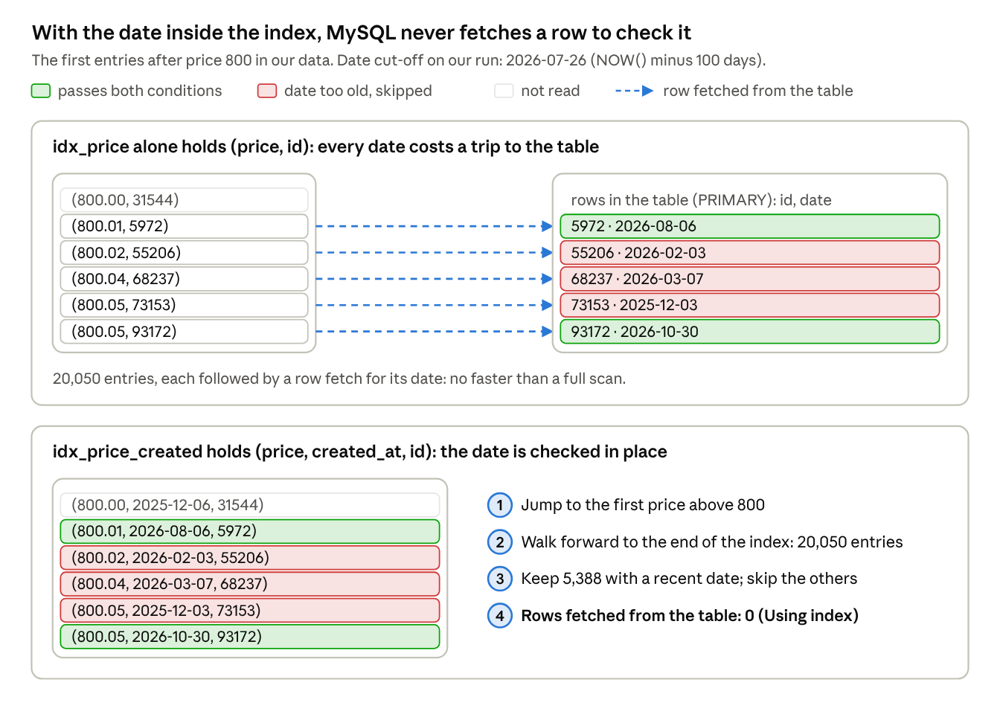
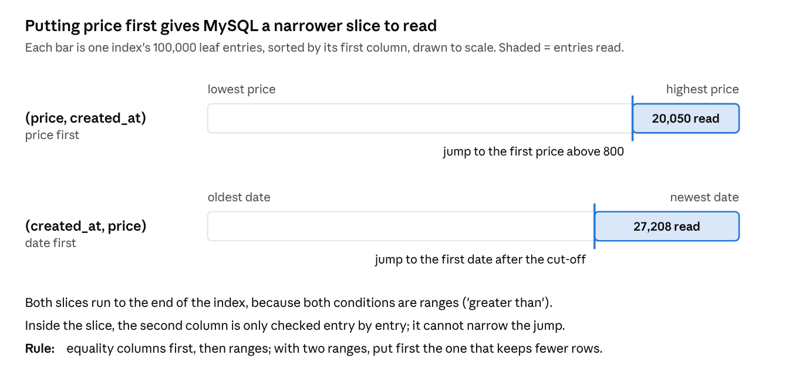
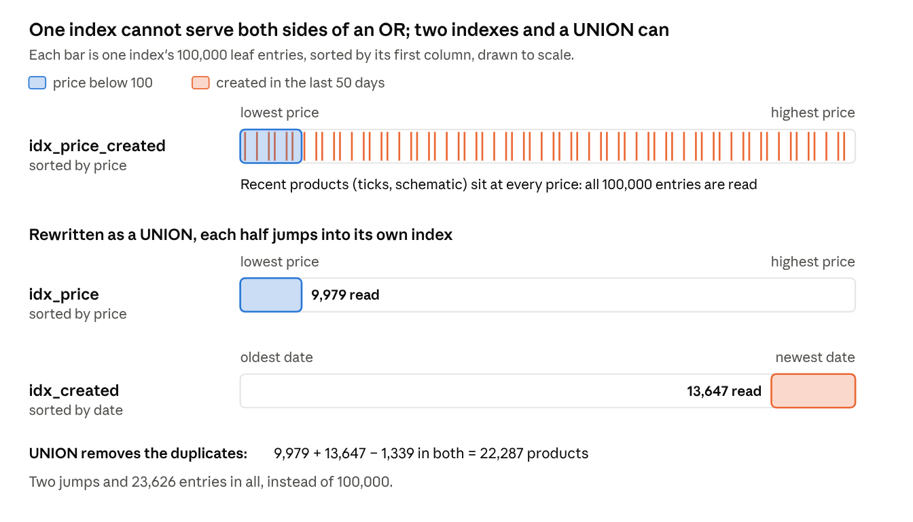
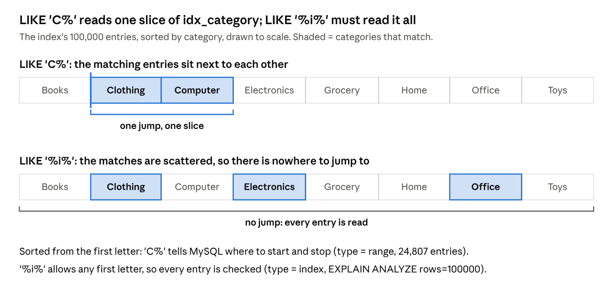
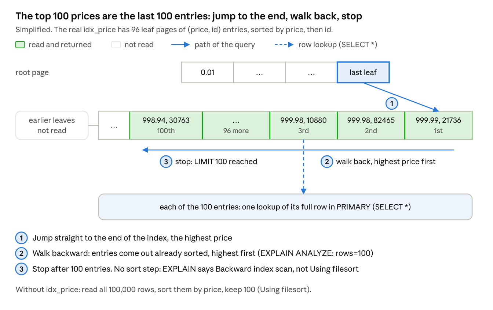
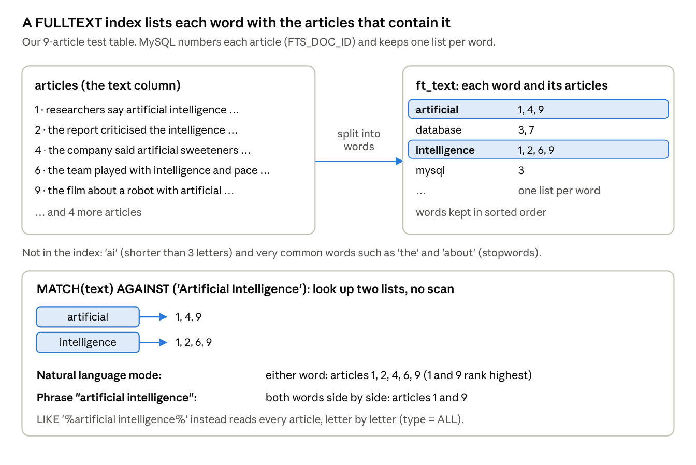

# Week 2 Tutorials

## Preparation

1. Create a new database, for example `shopping`, then select it.
2. Create a sample table `products`.
3. Create a stored procedure (you will learn about it later in the course) to insert sample data. In this sample, we insert 100,000 products. You can change the number at the beginning of the WHILE loop if needed.
4. Execute the stored procedure to insert sample products (this will take a while).

```sql
CREATE DATABASE shopping;
USE shopping;

CREATE TABLE products (
  id INT PRIMARY KEY AUTO_INCREMENT,
  name VARCHAR(100),
  category VARCHAR(50),
  price DECIMAL(10,2),
  stock INT,
  created_at DATETIME
);
```

The procedure `insert_sample_products()` and the `CALL` are given in full in Part A of the Student Guide below.

## Exercises

Execute the following query to view indexes of a table (for example, `products`):

```sql
SHOW INDEXES FROM products;
```

Write SQL queries to answer the following questions with and without indexes:

1. Find the number of products whose category is 'Books'.
2. Find the number of products whose prices are greater than 800 AND were created in the last 100 days.
3. Find the number of products whose prices are less than 100 OR were created in the last 50 days.
4. Find the number of products whose category contains the letter 'i'.
5. Find the 100 most expensive products.

## More exercises: FULLTEXT index

- Use MySQL Workbench to import data from `bbc-articles.csv` (downloaded from Canvas; source: Kaggle BBC fulltext and category dataset) to a new table. Instructions for the import are in the MySQL Workbench table export/import documentation.
- Find the articles that are relevant to Artificial Intelligence.
- Create a FULLTEXT index for the `text` column.
- Use `MATCH() AGAINST()` to search.
- Perform searches in natural language mode.

Natural language search:

```sql
SELECT *
FROM articles
WHERE MATCH(`text`) AGAINST ('Artificial Intelligence' IN NATURAL LANGUAGE MODE);
```

Display a relevance score:

```sql
SELECT *,
       MATCH(`text`) AGAINST ('Database Applications' IN NATURAL LANGUAGE MODE) AS score
FROM articles;
```

Perform searches in boolean mode.

Boolean search: require 'Artificial' and exclude 'Intelligence'.

```sql
SELECT *
FROM articles
WHERE MATCH(`text`) AGAINST ('+Artificial -Intelligence' IN BOOLEAN MODE);
```

Terms without `+` or `-` are optional. In the following example, 'Database' is required and 'MySQL' is optional; a match on 'MySQL' ranks higher.

```sql
SELECT *
FROM articles
WHERE MATCH(`text`) AGAINST ('+Database MySQL' IN BOOLEAN MODE);
```

## Student Guide (step by step)

### Before you start

Today you will build a table of 100,000 products, then run five queries twice: once without an index and once with an index you choose. Each time you will check how MySQL ran the query. By the end you should be able to:

- read `EXPLAIN` and tell whether a query used an index;
- choose the right index for a query: one column, or several columns in the right order;
- spot queries that no ordinary index can help, and say why.

You need: MySQL Server and Workbench from Week 1, and this week's lecture slides open (slides 37–49 are used most).

One setting to check first: in Workbench, open Edit → Preferences → SQL Editor (on macOS, MySQL Workbench → Preferences → SQL Editor). Set **DBMS connection read timeout** to 600, click OK, then choose Query → Reconnect to Server. You did this in Week 1, step 8. Without it, long statements stop with Error 2013 after 30 seconds.

### How to work through each exercise

1. **Predict.** Before running anything, write down what you expect. Wrong guesses are fine; they are where you learn the most.
2. **Run and measure.** Follow the steps exactly and record your numbers.
3. **Explain.** Answer the numbered questions (Q1, Q2, …) in your own notes. Your tutor will go through them at the end of the class.

The data is random, so your numbers will be close to the ones in this worksheet, not identical. That is expected.

### Your results table

Copy this table into your notes and fill it in as you go. Part B explains each column.

| # | Index you created | type / key before | type / key after | Rows read before | Rows read after | Time before (ms) | Time after (ms) |
|---|---|---|---|---|---|---|---|
| 1 | | | | | | | |
| 2 | | | | | | | |
| 3 | | | | | | | |
| 4 | | | | | | | |
| 5 | | | | | | | |

## Part A: Build your playground (about 15 minutes)

### Step 1. Create and select the database

```sql
CREATE DATABASE IF NOT EXISTS shopping;
USE shopping;
```

`USE` makes `shopping` the default, so later statements can say `products` instead of `shopping.products`.

### Step 2. Create the products table

```sql
CREATE TABLE products (
  id INT PRIMARY KEY AUTO_INCREMENT,
  name VARCHAR(100),
  category VARCHAR(50),
  price DECIMAL(10,2),
  stock INT,
  created_at DATETIME
);
```

### Step 3. Create the procedure that generates data

You will study stored procedures in Week 5. For now, copy the whole block and run it with Execute All (Ctrl+Shift+Enter, or the lightning-bolt button) with nothing selected.

```sql
DELIMITER $$
CREATE PROCEDURE insert_sample_products()
BEGIN
  DECLARE i INT DEFAULT 0;
  WHILE i < 100000 DO
    INSERT INTO products (name, category, price, stock, created_at)
    VALUES (
      CONCAT('Product ', (i + 1)),
      ELT(FLOOR(1 + RAND() * 8), 'Electronics', 'Computer', 'Books', 'Clothing', 'Toys',
          'Home', 'Grocery', 'Office'),
      ROUND(RAND() * 1000, 2),
      FLOOR(RAND() * 1000),
      NOW() - INTERVAL FLOOR(RAND() * 365) DAY
    );
    SET i = i + 1;
  END WHILE;
END$$
DELIMITER ;
```

What the important lines do:

- `DELIMITER $$` lets the procedure body contain `;` without Workbench thinking the statement has ended. `DELIMITER ;` switches back (keep the space).
- The `WHILE` loop runs the `INSERT` 100,000 times.
- `ELT(FLOOR(1 + RAND() * 8), …)` picks one of the 8 categories at random, so each gets about 1 row in 8.
- `ROUND(RAND() * 1000, 2)` makes a price from 0.00 to 999.99; `NOW() - INTERVAL … DAY` makes a date within the last 365 days.

Creating the procedure stores the code only. No rows are inserted yet.

### Step 4. Load the data

The tutorial page runs the procedure with a plain `CALL` (Option A). Option B wraps the same `CALL` in one transaction: it does exactly the same work, much faster. You will run both and measure the difference. Do the parts below in order, and run each code block on its own.

Run each option once only, and do not skip 4b: every `CALL` adds another 100,000 rows.

**4a. Option A: the plain CALL.** First note MySQL's count of forced disk writes, then load the data, then check the count again.

```sql
SHOW GLOBAL STATUS LIKE 'Innodb_os_log_fsyncs';   -- write down the Value
CALL insert_sample_products();
SHOW GLOBAL STATUS LIKE 'Innodb_os_log_fsyncs';   -- write down the new Value
```

The `CALL` can take from about a minute to several minutes. While it runs, read Part B. Record its Duration from the Output panel. If it stops with Error 2013, see "If you get stuck" at the end.

**4b. Empty the table.**

```sql
TRUNCATE TABLE products;
SELECT COUNT(*) FROM products;   -- should be 0
```

`TRUNCATE` removes every row but keeps the table and the procedure.

**4c. Option B: the same CALL inside one transaction.**

```sql
SHOW GLOBAL STATUS LIKE 'Innodb_os_log_fsyncs';   -- write down the Value
START TRANSACTION;
CALL insert_sample_products();
COMMIT;
SHOW GLOBAL STATUS LIKE 'Innodb_os_log_fsyncs';   -- write down the new Value
```

Workbench shows a Duration for each of the three lines; add them up.

**4d. Compare.** Copy this table into your notes. Disk log writes is the second Value minus the first.

| | Option A: plain CALL | Option B: one transaction |
|---|---|---|
| Time (seconds) | | |
| Disk log writes | | |

Check: on a test server, Option A took about 41 seconds with 108,312 disk log writes, and Option B about 1.6 seconds with 2,075. Your numbers will differ, but the gap should be just as large.

**Q1.** Both options inserted the same 100,000 rows. How many times slower was Option A, and how many more disk log writes did it make? MySQL normally commits every statement on its own (autocommit), and at every commit it must write to disk so the data survives a power cut. Using slides 21–22, explain where Option A's extra time goes.

### Step 5. Check your table

```sql
SELECT COUNT(*) FROM products;
SELECT category, COUNT(*) AS n
FROM products
GROUP BY category
ORDER BY n DESC;
SHOW INDEXES FROM products;
```

Check: 100,000 rows in total; each category close to 12,500; and `SHOW INDEXES` returns exactly one row. If you see 200,000 rows, you ran `CALL` twice: run `TRUNCATE TABLE products;`, then Option B once.

**Q2.** `SHOW INDEXES` lists one index. Which column is it on, and why does that column have an index although you never created one? (Hint: slides 14 and 39.)

## Part B: Your measuring toolkit

You will use the same three tools in every exercise. Queries on 100,000 rows finish in milliseconds and times jump around, so the plan and the number of rows read are your main evidence; time is supporting detail.

### Two Workbench habits

- Run one statement: click inside it and press Ctrl+Enter (Cmd+Enter on macOS).
- Run a whole script: select nothing and press Ctrl+Shift+Enter. Each statement that returns rows opens its own result tab at the bottom (Result 1, Result 2, …).

### Tool 1. Time

Run the query three times and record the middle value from the Duration column in Workbench's Output panel. The first run can be slower because data is still being read from disk into memory.

- Duration shows seconds with 3 decimals, so a very fast query shows as 0.000 sec. When that happens, use the time from `EXPLAIN ANALYZE` instead (Tool 3).
- Workbench quietly adds `LIMIT 1000` to a `SELECT *`. Before timing one, change **Limit to 1000 rows** to **Don't Limit** in the toolbar.

### Tool 2. EXPLAIN: how MySQL plans to run the query

Put `EXPLAIN` in front of any `SELECT`:

```sql
EXPLAIN SELECT COUNT(*) FROM products WHERE category = 'Books';
```

Look at five columns: `type`, `possible_keys`, `key`, `rows` and `Extra` (slide 44).

| You see | In column | It means |
|---|---|---|
| ALL | type | Full table scan: every row is read |
| index | type | The whole index is read from start to end, without jumping to a starting point |
| range | type | MySQL jumps to a starting point in the index and reads one slice |
| ref | type | MySQL jumps straight to entries equal to a value |
| NULL | key | No index was used |
| Using index | Extra | The answer came from the index alone; the table rows were never read |
| Using where | Extra | Rows or index entries are checked against the WHERE condition after being read |
| Using filesort | Extra | MySQL had to sort the results itself |
| Backward index scan | Extra | The index was read from the end towards the start |

`rows` is only MySQL's estimate, and it can be far off. Tool 3 gives real numbers.

### Tool 3. EXPLAIN ANALYZE: what really happened

```sql
EXPLAIN ANALYZE SELECT COUNT(*) FROM products WHERE category = 'Books';
```

This actually runs the query and reports the real rows and milliseconds of each step. Workbench shows the result in one cell: right-click it and choose **Open Value in Viewer**. Read it from the most indented line upwards.

**Rows read:** the `rows=` on the most indented line, the scan or index line, is how many rows or index entries MySQL actually read. For example, `Table scan on products … rows=100000` means every row was read. Use this number for the Rows read columns of your results table.

An example, from Exercise 1 before any index:

```
-> Aggregate: count(0)  (cost=11086 rows=1) (actual time=23.9..23.9 rows=1 loops=1)
    -> Filter: (products.category = 'Books')  (cost=10088 rows=9984) (actual time=0.0763..23.3 rows=12428 loops=1)
        -> Table scan on products  (cost=10088 rows=99836) (actual time=0.0725..16.6 rows=100000 loops=1)
```

- Rows read: 100,000, from the most indented line.
- Time: the second number of `actual time` on the top line, here 23.9 ms.
- The `cost=… rows=…` before `actual time` is MySQL's estimate, made before running. Compare it with the real numbers, but do not record it.

### Commands for managing indexes

```sql
CREATE INDEX idx_category ON products (category);   -- create (name: idx_ + column)
ANALYZE TABLE products;                             -- refresh MySQL's estimates
SHOW INDEXES FROM products;                         -- list the indexes
DROP INDEX idx_category ON products;                -- remove
-- Compare without dropping: tell MySQL to ignore, or to use, one index
SELECT COUNT(*) FROM products IGNORE INDEX (idx_category) WHERE category = 'Books';
SELECT COUNT(*) FROM products FORCE INDEX (idx_category) WHERE category = 'Books';
```

`ANALYZE TABLE` refreshes the statistics MySQL uses to choose a plan. It changes no data; run it after creating an index so `EXPLAIN` works with up-to-date numbers.

**Clean-up rule:** at the end of every exercise, drop the indexes you created, so `SHOW INDEXES` lists only PRIMARY. Indexes left over from one exercise can change the plan of the next.

## Exercise 1: Count the products in 'Books' (worked example)

Task: find the number of products whose category is 'Books'. This exercise shows every step in full; later exercises follow the same pattern.

**Predict:** only 1 product in 8 is a Book. Will an index on `category` make this count much faster, a little faster, or no faster? Write your guess down.

### Step 1. Write and run the query

Try writing it yourself first, then compare:

```sql
SELECT COUNT(*) FROM products WHERE category = 'Books';
```

Check: the answer should be close to 12,500.

### Step 2. Measure before the index

Run this script with nothing selected (Ctrl+Shift+Enter):

```sql
SHOW INDEXES FROM products;
EXPLAIN SELECT COUNT(*) FROM products WHERE category = 'Books';
EXPLAIN ANALYZE SELECT COUNT(*) FROM products WHERE category = 'Books';
```

Then click inside the Step 1 query and run it on its own three times (Ctrl+Enter). Note the middle Duration.

Check: `SHOW INDEXES` lists only PRIMARY. `EXPLAIN` shows `type = ALL` and `key = NULL`. The most indented line of `EXPLAIN ANALYZE` says `Table scan on products … rows=100000`.

Record the before columns of row 1 in your results table: type and key from `EXPLAIN`, rows read from `EXPLAIN ANALYZE`, and the time.



Diagram 1: full table scan · the clustered index walked leaf by leaf

Picture it: this is what you just measured. The table itself is a B+-tree sorted by `id` (slide 39), so MySQL has to check every row in every leaf.

### Step 3. Create the index

```sql
CREATE INDEX idx_category ON products (category);
ANALYZE TABLE products;
SHOW INDEXES FROM products;
```

Check: `SHOW INDEXES` now lists two indexes: PRIMARY on `id` and `idx_category` on `category`.

### Step 4. Measure again

The same script as Step 2, without `SHOW INDEXES`:

```sql
EXPLAIN SELECT COUNT(*) FROM products WHERE category = 'Books';
EXPLAIN ANALYZE SELECT COUNT(*) FROM products WHERE category = 'Books';
```

Time the Step 1 query three times again, then fill in the after columns of row 1.

**Q3.** What changed in `type`, `key`, `Extra` and the number of rows read? About how many times faster was the query?

**Q4.** `Extra` now says `Using index`, and `EXPLAIN ANALYZE` says `Covering index lookup`. Using slide 39, explain how MySQL counted the Books products without reading a single row of the table. Hint: what does each entry in `idx_category` contain, and how are the entries ordered?

Look closer: `EXPLAIN`'s `rows` column is only an estimate. How far is it from the real `rows=` in `EXPLAIN ANALYZE`?

### Step 5. Change one word: ask for whole rows

First change **Limit to 1000 rows** to **Don't Limit** in the Workbench toolbar. Then run:

```sql
EXPLAIN SELECT * FROM products WHERE category = 'Books';
EXPLAIN ANALYZE SELECT * FROM products WHERE category = 'Books';
EXPLAIN SELECT * FROM products IGNORE INDEX (idx_category) WHERE category = 'Books';
EXPLAIN ANALYZE SELECT * FROM products IGNORE INDEX (idx_category) WHERE category = 'Books';
```

For the time, read the second number of `actual time` on the top line of each `EXPLAIN ANALYZE` result.

**Q5.** Compare with Step 4: which words disappeared from `Extra`, and from the `EXPLAIN ANALYZE` line? What extra work must MySQL now do for each of the roughly 12,500 matching entries? (Slide 39 again.)

Look closer: was the index still faster than `IGNORE INDEX`? Would that stay true on a table too big to fit in memory? (Slide 47.)



Diagram 2: `idx_category` · one jump, a walk along the leaves, and the extra lookup for `SELECT *`

Check your thinking: answer Q4 and Q5 first, then compare your answers with this picture of `idx_category`.

### Clean up

```sql
DROP INDEX idx_category ON products;
SHOW INDEXES FROM products;   -- only PRIMARY again
```

## Exercise 2: price > 800 AND created in the last 100 days

Task: find the number of products whose price is greater than 800 and that were created in the last 100 days.

**Predict:** you will try two designs: (a) two separate indexes, one on each column; (b) one index on both columns together. Which do you expect to be faster, and why?

### Step 1. Write and run the query

Hint: "in the last 100 days" means `created_at >= NOW() - INTERVAL 100 DAY`.

```sql
SELECT COUNT(*) FROM products
WHERE price > 800
  AND created_at >= NOW() - INTERVAL 100 DAY;
```

Check: about 20% of prices are above 800 and about 27% of dates fall in the last 100 days, so expect roughly 20% × 27% × 100,000 ≈ 5,400.

### Step 2. Measure before any index

```sql
SHOW INDEXES FROM products;   -- only PRIMARY
EXPLAIN SELECT COUNT(*) FROM products
WHERE price > 800 AND created_at >= NOW() - INTERVAL 100 DAY;
EXPLAIN ANALYZE SELECT COUNT(*) FROM products
WHERE price > 800 AND created_at >= NOW() - INTERVAL 100 DAY;
```

Time the Step 1 query three times, then record the before columns of row 2.

Check: `type = ALL`, and the most indented line of `EXPLAIN ANALYZE` says `Table scan on products … rows=100000`.

### Step 3. Try two separate indexes

```sql
CREATE INDEX idx_price   ON products (price);
CREATE INDEX idx_created ON products (created_at);
ANALYZE TABLE products;
EXPLAIN SELECT COUNT(*) FROM products
WHERE price > 800 AND created_at >= NOW() - INTERVAL 100 DAY;
EXPLAIN ANALYZE SELECT COUNT(*) FROM products
WHERE price > 800 AND created_at >= NOW() - INTERVAL 100 DAY;
```

Look at `possible_keys`, `key` and the `EXPLAIN ANALYZE` lines. Time the Step 1 query again.

### Step 4. Force MySQL to use idx_price

```sql
EXPLAIN ANALYZE SELECT COUNT(*) FROM products FORCE INDEX (idx_price)
WHERE price > 800 AND created_at >= NOW() - INTERVAL 100 DAY;
```

Read the lines from the most indented up: how many entries did the index give, and how many rows survived the Filter line? Compare the top line's time with Step 3.

**Q6.** In Step 3, did MySQL use either index? Each index on its own matches about 20,000–27,000 products. What would MySQL have to do for each of those products to check the other condition? Using your Step 4 result and slides 46–47, explain why MySQL decided it was not worth it.

### Step 5. Try one composite index

```sql
CREATE INDEX idx_price_created ON products (price, created_at);
ANALYZE TABLE products;
EXPLAIN SELECT COUNT(*) FROM products
WHERE price > 800 AND created_at >= NOW() - INTERVAL 100 DAY;
EXPLAIN ANALYZE SELECT COUNT(*) FROM products
WHERE price > 800 AND created_at >= NOW() - INTERVAL 100 DAY;
```

Time the Step 1 query again and record the after columns of row 2.

Look closer: compare the `EXPLAIN ANALYZE` index line with Step 4. The number of entries is the same. Which word is new, and what does it save MySQL from doing?



Diagram 3: `idx_price` vs `idx_price_created` · the same entries, with and without the date inside

Check your thinking: answer Q6 and the "Look closer" above first, then compare your answers with this picture.

### Step 6. Swap the column order

```sql
DROP INDEX idx_price_created ON products;
CREATE INDEX idx_created_price ON products (created_at, price);
ANALYZE TABLE products;
EXPLAIN ANALYZE SELECT COUNT(*) FROM products
WHERE price > 800 AND created_at >= NOW() - INTERVAL 100 DAY;
```

Write down the `rows=` on the index line for both column orders: Step 5 and Step 6.

**Q7.** Which column order read fewer index entries: (price, created_at) or (created_at, price)? Both conditions are ranges (`>` and `>=`). Using slide 49, explain why only the first column can narrow the search, and write a rule for choosing which column goes first.



Diagram 4: column order · the slice each composite index reads, to scale

Check your thinking: answer Q7 first, then compare your rule with this picture.

### Clean up

```sql
DROP INDEX idx_price ON products;
DROP INDEX idx_created ON products;
DROP INDEX idx_created_price ON products;
SHOW INDEXES FROM products;   -- only PRIMARY again
```

## Exercise 3: price < 100 OR created in the last 50 days

Task: find the number of products whose price is less than 100 or that were created in the last 50 days.

**Predict:** this is Exercise 2 with OR instead of AND. Will the same indexes help as much? Can one index serve both sides of an OR?

### Step 1. Write and run the query

```sql
SELECT COUNT(*) FROM products
WHERE price < 100
   OR created_at >= NOW() - INTERVAL 50 DAY;
```

Check: about 10% of prices are below 100 and about 14% of dates fall in the last 50 days. Some products are in both groups, so expect a little under 24,000 (about 22,000).

### Step 2. Measure before any index

```sql
SHOW INDEXES FROM products;   -- only PRIMARY
EXPLAIN SELECT COUNT(*) FROM products
WHERE price < 100 OR created_at >= NOW() - INTERVAL 50 DAY;
EXPLAIN ANALYZE SELECT COUNT(*) FROM products
WHERE price < 100 OR created_at >= NOW() - INTERVAL 50 DAY;
```

Time the Step 1 query three times, then record the before columns of row 3.

### Step 3. Try two separate indexes

```sql
CREATE INDEX idx_price   ON products (price);
CREATE INDEX idx_created ON products (created_at);
ANALYZE TABLE products;
EXPLAIN SELECT COUNT(*) FROM products
WHERE price < 100 OR created_at >= NOW() - INTERVAL 50 DAY;
EXPLAIN ANALYZE SELECT COUNT(*) FROM products
WHERE price < 100 OR created_at >= NOW() - INTERVAL 50 DAY;
```

Look at `possible_keys`, `key` and the most indented `EXPLAIN ANALYZE` line. Time the Step 1 query again.

### Step 4. Add the composite index from Exercise 2

```sql
CREATE INDEX idx_price_created ON products (price, created_at);
ANALYZE TABLE products;
EXPLAIN SELECT COUNT(*) FROM products
WHERE price < 100 OR created_at >= NOW() - INTERVAL 50 DAY;
EXPLAIN ANALYZE SELECT COUNT(*) FROM products
WHERE price < 100 OR created_at >= NOW() - INTERVAL 50 DAY;
```

Look at `type` and the `rows=` on the index line. Time the Step 1 query again.

**Q9.** Did any of these indexes make the query noticeably faster? `idx_price` keeps products sorted by price. Where in that index are the products created in the last 50 days? Use this to explain why one index cannot serve both sides of an OR.

### Step 5. Rewrite the query as a UNION

Remove the composite index, keep the two single ones, and split the OR into two simple queries joined by `UNION`:

```sql
DROP INDEX idx_price_created ON products;
SELECT COUNT(*) FROM (
  SELECT id FROM products WHERE price < 100
  UNION
  SELECT id FROM products WHERE created_at >= NOW() - INTERVAL 50 DAY
) AS t;
```

Check: the count must be the same as in Step 1.

Now measure it:

```sql
EXPLAIN SELECT COUNT(*) FROM (
  SELECT id FROM products WHERE price < 100
  UNION
  SELECT id FROM products WHERE created_at >= NOW() - INTERVAL 50 DAY
) AS t;
EXPLAIN ANALYZE SELECT COUNT(*) FROM (
  SELECT id FROM products WHERE price < 100
  UNION
  SELECT id FROM products WHERE created_at >= NOW() - INTERVAL 50 DAY
) AS t;
```

`EXPLAIN` now returns several rows, one per part of the query. For Rows read, add up the `rows=` on the two index lines of `EXPLAIN ANALYZE`. Time the `UNION` query three times and record the after columns of row 3.

**Q10.** In the `EXPLAIN` output, which index does each half use, and what does `Extra` say for each? Why does the rewrite let MySQL use both indexes when the original OR query could not?



Diagram 5: OR vs UNION · where each half of the condition sits in each index, to scale

Check your thinking: answer Q9 and Q10 first, then compare your answers with this picture.

### Step 6. UNION vs UNION ALL

```sql
SELECT COUNT(*) FROM (
  SELECT id FROM products WHERE price < 100
  UNION ALL
  SELECT id FROM products WHERE created_at >= NOW() - INTERVAL 50 DAY
) AS t;
```

**Q11.** Why is this count different from Step 5, and which one answers the task correctly?

### Clean up

```sql
DROP INDEX idx_price ON products;
DROP INDEX idx_created ON products;
SHOW INDEXES FROM products;   -- only PRIMARY again
```

## Exercise 4: Categories containing the letter 'i'

Task: find the number of products whose category contains the letter 'i'.

**Predict:** will an index on `category` help this time? Think of the phone book on slide 40.

### Step 1. Write and run the query

Hint: in `LIKE`, the `%` sign matches any characters, including none.

```sql
SELECT COUNT(*) FROM products WHERE category LIKE '%i%';
```

To see which categories matched:

```sql
SELECT category, COUNT(*) FROM products
WHERE category LIKE '%i%'
GROUP BY category;
```

Check: 3 of the 8 categories contain an 'i', so expect roughly 37,500 products. Is Computer one of them?

### Step 2. Measure before any index

```sql
SHOW INDEXES FROM products;   -- only PRIMARY
EXPLAIN SELECT COUNT(*) FROM products WHERE category LIKE '%i%';
EXPLAIN ANALYZE SELECT COUNT(*) FROM products WHERE category LIKE '%i%';
```

Time the Step 1 count three times, then record the before columns of row 4.

### Step 3. Create an index on category and measure again

```sql
CREATE INDEX idx_category ON products (category);
ANALYZE TABLE products;
EXPLAIN SELECT COUNT(*) FROM products WHERE category LIKE '%i%';
EXPLAIN ANALYZE SELECT COUNT(*) FROM products WHERE category LIKE '%i%';
```

Time the Step 1 count again and record the after columns of row 4. Look carefully at `type`, `possible_keys`, `key` and the `rows=` on the index line.

**Q12.** `possible_keys` is NULL, yet `key` is `idx_category`. What does each of these two columns tell you, and how can both be true? Did MySQL read part of the index or all of it?

### Step 4. Compare with a search on the first letter

```sql
SELECT COUNT(*) FROM products WHERE category LIKE 'C%';
EXPLAIN SELECT COUNT(*) FROM products WHERE category LIKE 'C%';
EXPLAIN ANALYZE SELECT COUNT(*) FROM products WHERE category LIKE 'C%';
```

**Q13.** What is `type` now, and how many index entries were read? Using the phone book idea (slide 40), explain why `'C%'` lets MySQL jump to a starting point but `'%i%'` does not.

Look closer (optional): slide 55 asks you to count categories, not products. Which query answers that, and what is the answer?



Diagram 6: `idx_category` by category, to scale · `LIKE 'C%'` vs `LIKE '%i%'`

Check your thinking: answer Q12 and Q13 first, then compare your answers with this picture.

### Clean up

```sql
DROP INDEX idx_category ON products;
SHOW INDEXES FROM products;   -- only PRIMARY again
```

## Exercise 5: The 100 most expensive products

Task: find the 100 most expensive products.

**Predict:** without an index, MySQL must look at all 100,000 products to be sure it has the top 100. With an index on `price`, how many index entries do you think it needs to read?

### Step 1. Write and run the query

```sql
SELECT * FROM products ORDER BY price DESC LIMIT 100;
```

Check: 100 rows, with the first price close to 999.99.

### Step 2. Measure before any index

```sql
SHOW INDEXES FROM products;   -- only PRIMARY
EXPLAIN SELECT * FROM products ORDER BY price DESC LIMIT 100;
EXPLAIN ANALYZE SELECT * FROM products ORDER BY price DESC LIMIT 100;
```

Time the Step 1 query three times, then record the before columns of row 5. Note what `Extra` says, and find the Sort line in `EXPLAIN ANALYZE`.

### Step 3. Create an index on price and measure again

```sql
CREATE INDEX idx_price ON products (price);
ANALYZE TABLE products;
EXPLAIN SELECT * FROM products ORDER BY price DESC LIMIT 100;
EXPLAIN ANALYZE SELECT * FROM products ORDER BY price DESC LIMIT 100;
```

Time the Step 1 query again and record the after columns of row 5. In `EXPLAIN ANALYZE`, look for the word `reverse` and the `rows=` on the index line. If Duration shows 0.000 sec, use the time from `EXPLAIN ANALYZE`.

**Q14.** Compare before and after: `type`, `rows`, `Extra` and the `rows=` in `EXPLAIN ANALYZE`. Using slides 37–38, explain why MySQL no longer needs to sort anything, and why it reads only about 100 index entries.



Diagram 7: `idx_price` read backward · `ORDER BY price DESC LIMIT 100`

Check your thinking: answer Q14 first, then compare your answer with this picture.

### Step 4. Ask for more rows

```sql
EXPLAIN SELECT * FROM products ORDER BY price DESC LIMIT 400;
EXPLAIN SELECT * FROM products ORDER BY price DESC LIMIT 500;
EXPLAIN SELECT * FROM products ORDER BY price DESC LIMIT 20000;
```

**Q15.** What changed in the plan? Why would MySQL stop using the index when you ask for many more rows? (Slides 46–47.)

Look closer: try other `LIMIT` values. Where does the plan switch on your laptop?

### Step 5. A stable order for ties

Many products share the same price, so products tied at position 100 can come back in a different order from run to run. Adding the primary key fixes the order:

```sql
EXPLAIN SELECT * FROM products ORDER BY price DESC, id DESC LIMIT 100;
```

Look closer: does MySQL still use `idx_price` for this order? Why can it? (Hint: what is stored in each entry of a secondary index?)

### Clean up

```sql
DROP INDEX idx_price ON products;
SHOW INDEXES FROM products;   -- only PRIMARY again
```

## Optional extension: FULLTEXT search on BBC articles

Do this if you finish Exercise 5 early, or at home. Exercise 4 showed that a normal index cannot search inside text. A FULLTEXT index can: it records, for every word, which rows contain it. Allow 15–20 minutes. Questions here are numbered F1–F5.

### Step 1. Get the file

1. Download `bbc-articles.csv` from Canvas.
2. Visit the dataset's Kaggle page to see where the articles come from (link in Further Reading).
3. Open the CSV in a text editor (Notepad, VS Code), not Excel. The first line should be `category,text`. Do not save it from Excel: that can break the import.

### Step 2. Import it with Workbench

1. In the Navigator, right-click the `shopping` schema and choose **Table Data Import Wizard**.
2. Browse to `bbc-articles.csv`, then Next.
3. Choose **Create new table** and name it `articles`, then Next.
4. Check that two columns are listed, `category` and `text`, then Next.
5. Click Next to import (allow a minute or two), then Finish.

```sql
SELECT COUNT(*) FROM articles;
SELECT category, COUNT(*) FROM articles GROUP BY category;
```

Check: five categories: business, entertainment, politics, sport and tech.

### Step 3. Search the old way

```sql
SELECT COUNT(*) FROM articles WHERE `text` LIKE '%artificial intelligence%';
EXPLAIN SELECT COUNT(*) FROM articles WHERE `text` LIKE '%artificial intelligence%';
```

Note the `type`. You have seen this situation before, in Exercise 4.

### Step 4. Try a FULLTEXT search before creating the index

```sql
SELECT * FROM articles
WHERE MATCH(`text`) AGAINST ('Artificial Intelligence' IN NATURAL LANGUAGE MODE);
```

**F1.** What error do you get? In Exercises 1–5, every query ran with or without an index. What does this error tell you about FULLTEXT search compared with a normal index?

### Step 5. Create the FULLTEXT index

```sql
CREATE FULLTEXT INDEX ft_text ON articles (`text`);
SHOW INDEXES FROM articles;
```

A warning about `FTS_DOC_ID` is normal: InnoDB adds a hidden column it needs. Look at `Index_type` in `SHOW INDEXES`.

Now run the query from Step 4 again, with and without `EXPLAIN`.

### Step 6. Rank articles by relevance

```sql
SELECT category, LEFT(`text`, 80) AS snippet,
       MATCH(`text`) AGAINST ('Artificial Intelligence' IN NATURAL LANGUAGE MODE) AS score
FROM articles
ORDER BY score DESC
LIMIT 10;
```

`LEFT(…, 80)` shows only the first 80 characters of each article. The tutorial page also scores 'Database Applications'; try that too.

#### How the relevance score is calculated

InnoDB scores each search word in an article, then adds the scores. In simplified form:

```
score = sum over search words of ( TF × IDF² ),  where IDF = log10(total articles ÷ articles containing the word)
```

- **TF (term frequency)** reflects how often the word appears in the article.
- **IDF (inverse document frequency)** reflects how rare the word is across the articles. A rarer word contributes more; a word in every article has an IDF of 0.

For a separate nine-article example, suppose 'artificial' appears in three articles and 'intelligence' in four. The following illustrates the scores for articles containing each word once; these are not expected scores for the BBC dataset.

| Article contains | Simplified calculation | Illustrative score |
|---|---|---|
| 'artificial' once | 1 × (log₁₀(9 ÷ 3))² | 0.2276 |
| 'intelligence' once | 1 × (log₁₀(9 ÷ 4))² | 0.1240 |
| Both, once each | 0.2276 + 0.1240 | About 0.3517 before rounding the component scores |

**F2.** Read the top results and a few lower down. Does every match really talk about artificial intelligence? Which word made the others match?

### Step 7. Be precise with boolean mode

| You write | It means |
|---|---|
| `+word` | Must contain the word |
| `-word` | Must not contain the word |
| `word` | Optional; articles containing it rank higher |
| `"two words"` | The exact phrase, words side by side |
| `word*` | Any word starting with these letters |

```sql
-- the tutorial page's two boolean searches
SELECT * FROM articles
WHERE MATCH(`text`) AGAINST ('+Artificial -Intelligence' IN BOOLEAN MODE);
SELECT * FROM articles
WHERE MATCH(`text`) AGAINST ('+Database MySQL' IN BOOLEAN MODE);

-- an exact phrase: double quotes inside single quotes
SELECT * FROM articles
WHERE MATCH(`text`) AGAINST ('"artificial intelligence"' IN BOOLEAN MODE);
```

**F3.** Which search best answers "find the articles about Artificial Intelligence": natural language mode, `'+Artificial -Intelligence'`, or the phrase? Explain your choice.



Diagram 8: FULLTEXT index · one list of articles per word, and how `MATCH` uses it

Check your thinking: answer F2 and F3 first, then compare your answers with this picture of the FULLTEXT index.

### Step 8. Find the limits

```sql
SELECT COUNT(*) FROM articles
WHERE MATCH(`text`) AGAINST ('AI' IN NATURAL LANGUAGE MODE);
SHOW VARIABLES LIKE 'innodb_ft_min_token_size';
```

**F4.** Why does searching for 'AI' return nothing, even if articles contain it?

**F5.** Could a FULLTEXT index solve Exercise 4 (categories containing the letter 'i')? Explain why or why not.

## If you get stuck

| You see | Try this |
|---|---|
| Error 2013: Lost connection during query | Set the read timeout to 600 (see Before you start), reconnect, then check `SELECT COUNT(*) FROM products;` before running anything again |
| 200,000 rows instead of 100,000 | You ran `CALL` twice: `TRUNCATE TABLE products;` then load once |
| Error 1064 when creating the procedure | Run the whole block from `DELIMITER $$` to `DELIMITER ;` with nothing selected |
| Error 1304: PROCEDURE … already exists | It is already there. Just `CALL` it, or `DROP PROCEDURE insert_sample_products;` and create it again |
| Error 1007: database exists | `USE shopping;` and carry on |
| Error 1046: No database selected | `USE shopping;` |
| Error 1061: Duplicate key name | The index already exists: check `SHOW INDEXES FROM products;` |
| Error 1091: Can't DROP … | That index does not exist: check its exact name with `SHOW INDEXES` |
| Error 1191: Can't find FULLTEXT index | Create the FULLTEXT index first (extension, Step 5) |
| `EXPLAIN ANALYZE` is one long line | Right-click the cell → Open Value in Viewer |
| My plan or numbers differ from the worksheet | Your data is random. Run `ANALYZE TABLE products;`, then compare with your neighbour and discuss the difference |

Still stuck? Ask your lecturer!

## Further Reading

- [BBC fulltext and category dataset (Kaggle)](https://www.kaggle.com/datasets/yufengdev/bbc-fulltext-and-category)
- [MySQL Workbench: table data export and import wizard](https://dev.mysql.com/doc/workbench/en/wb-admin-export-import-table.html)
- [MySQL 8.0 Reference Manual: CREATE INDEX](https://dev.mysql.com/doc/refman/8.0/en/create-index.html)
- [MySQL 8.4 Reference Manual: Full-Text Search Functions](https://dev.mysql.com/doc/refman/8.4/en/fulltext-search.html)
- [MySQL 8.4 Reference Manual: Natural Language Full-Text Searches](https://dev.mysql.com/doc/refman/8.4/en/fulltext-natural-language.html)
- [MySQL 8.4 Reference Manual: Boolean Full-Text Searches](https://dev.mysql.com/doc/refman/8.4/en/fulltext-boolean.html)
