# Process Model

## What is the Process Model

A process model is a structured collection of practices that describe the characteristics of effective process.

Many different software processes but all involve:

- <u>Specification</u> – defining what the system should do
- <u>Design</u> and <u>implementation</u> – defining the organization of the system and implementing the system
- <u>Validation</u> – checking that it does what the customer wants;
- <u>Evolution</u> – changing the system in response to changing customer needs

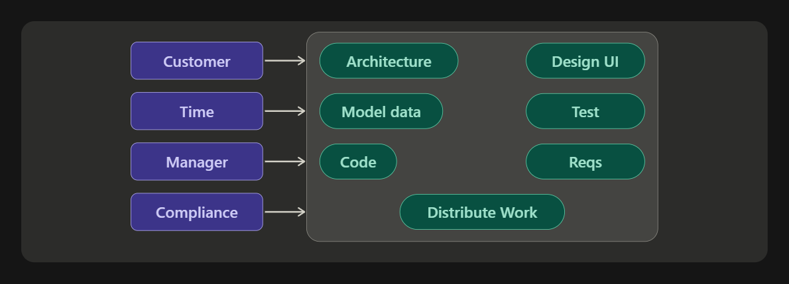

**Software processes** define the **who**, **what**, **when**, and **how** of developing software.

For example: A software process should specify the activities (how) a tester (who) should do, the order of these activities (when), and the artifacts (what) that should be produced by a tester.

### How Is a Process Model Used?

A process model is used

- To help set process improvement objectives and priorities
- To help ensure stable, capable, and mature processes
- As a guide for improvement of project and organizational processes
- With an appraisal method to diagnose the state of an organization's current practices

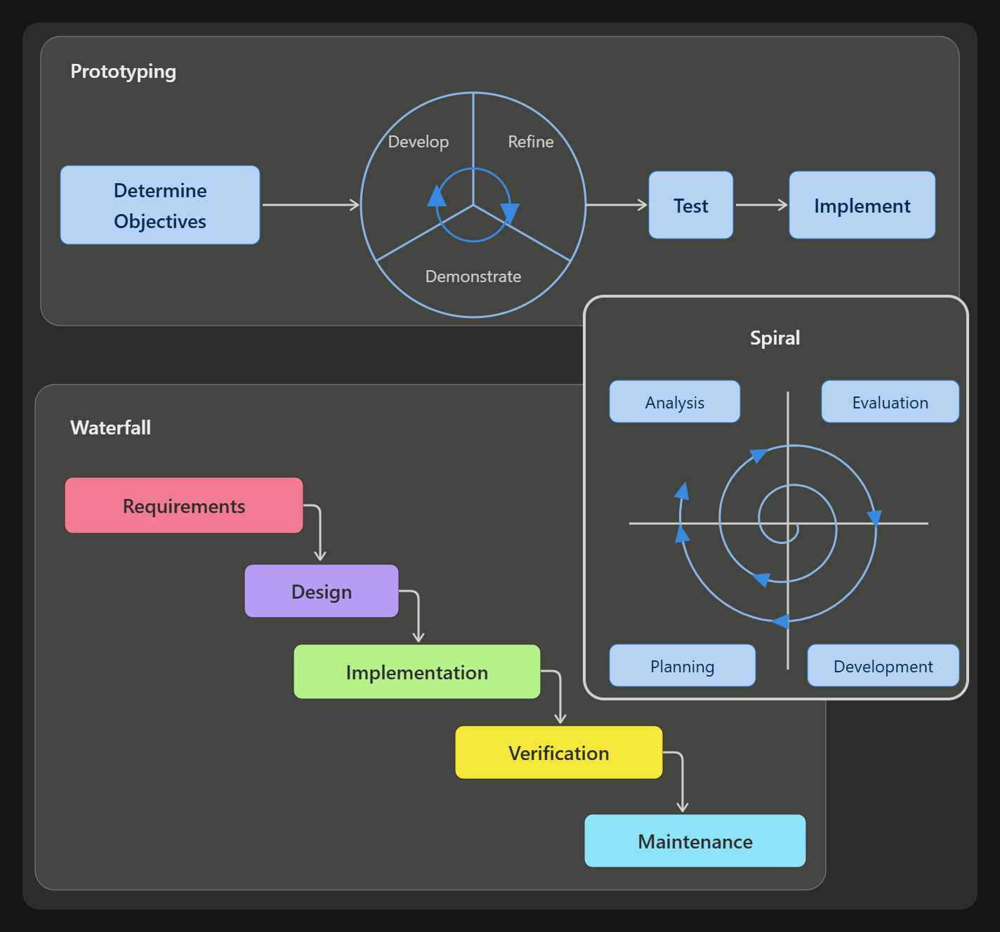

### Why Is a Process Model Important?

A process model provides

- A place to start improving
- The benefit of a community's prior experiences
- A common language and a shared vision
- A framework for prioritizing actions
- A way to define what improvement means for an organization

## Plan-driven (heavy) vs Agile (light) Processes

- In Plan-driven processes, all of the activities are planned in advance and progress is measured against this plan. Plan drives everything!
- In Agile Processes planning is incremental, and it is *easier to change* the process to reflect changing requirements.
- In practice, most practical processes include elements of both plan-driven and agile. There are no right or wrong software processes.
> What type of process would suit us for the assignment?
>
> How can we understand the idea, communicate with each other, clarify what needs to be done, estimate how much time it will take and how much is it going to cost?

## Software Development Lifecycles (SDLC)

- An SDLC is a process that produces software with the highest quality and lowest cost in the shortest time
- It is composed of stages.

### Project Management Triangle

| Quality | Description |
|---|---|
| Time | The actual time required to produce a deliverable. Related to the amount of requirements and resources allocated |
| Cost | The amount of money needed to complete the project. How does the time allocated affect the cost? |
| Scope | The functional elements that make up the project deliverables. The common success measure is its inherent quality upon delivery. |

## Common Process Models

- Code and Fix Model
- Waterfall
- Rational Unified Process (RUP)
- Agile Development Cycle
  - Agile Unified Process (AUP)
  - eXtreme Programming (XP)
  - Scrum
  - Kanban
- Rapid Application Development (RAD)

### Code and Fix Model

- Work from a brief specification of tasks
- Developers immediately translate tasks into code.
- Testing is carried out after all development work is completed
- Developers would have no idea if they were producing what the customer wanted.
- Approach worked well for scientific applications and batched programs where all development work is done by a single person.
- But this approach did not scale well for larger applications

### Waterfall

**Requirements** → **Design** → **Implementation** → **Verification** → **Maintenance**

Follows a sequential, linear process and is the most popular version of the systems development life cycle (SDLC) for software engineering and IT projects.

#### Requirements

Requirements are what the user needs and what the system needs to have.

| Functional Requirements | Non Functional Requirements |
|---|---|
| Behaviours we expect the system to have. | Also called *quality attributes*. |
| Functionalities that can be directly implemented. | Other features that the system must conform (change screens fast enough, be pretty, be secure, do not take the whole CPU capacity). |
| There are several techniques to get these from the users. | Hard to capture, document, and get from the user. |

### Rational Unified Process (RUP)

- This methodology divides the development process into four distinct phases that each involves business modeling, analysis and design, implementation, testing, and deployment.
- This is an object-oriented and web-enabled program development methodology.
- This model also helps software developer for providing them guidelines, templates, and examples for all aspects and stages of software development.

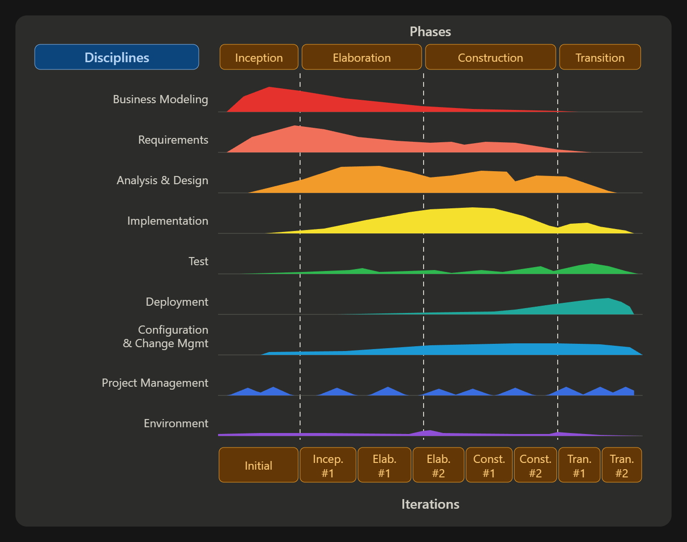

## Agile Software Development

### What is Agile?

A set of principles for software development under which requirements and solutions evolve through the collaborative effort of self-organizing cross functional teams.

Is an iterative approach to software delivery that builds software incrementally from the start of the project, instead of trying to deliver it all at once near the end.

### Agility Values

Four important values of the Agile software development model

1. Individuals and interactions rather than processes and tools.
2. Development of working software
3. Collaboration with the customer or client
4. Quickly Responding to change

Agile is a type of methodology. There are tons of agile SDLC, some more used than others!

But in general, they all abide by the 4 values, and the 12 principles that are listed in the Agile Manifesto.

## Agile SDLC are iterative and incremental

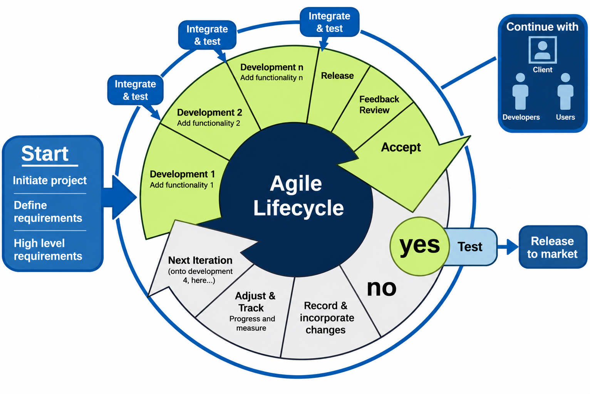

- **Iterative** means that it is a cycle that repeats over and over.
- **Incremental** means that you start with the basics, and each cycle (iteration!) builds on top of the previous one, making the system larger and more complex.

### 1. Scrum

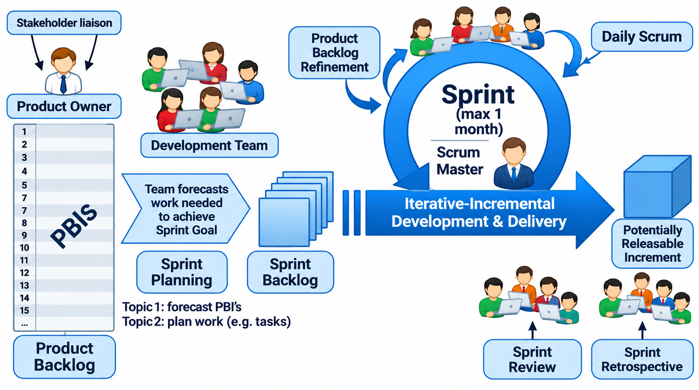

#### Backlogs

- The *product backlog* represents the larger picture and lists epics and stories for a product.
- A *sprint backlog* is concerned with the stories and tasks that are to be undertaken within a sprint. The items in sprint backlogs come from the product backlog during sprint planning.
- Note: There is another term used at times called *Epic* - a larger requirement or composite user story that needs to be broken down into small segments during software development.

#### Requirements with User Stories

- Instead of Use Cases, Agile project owners do "user stories"
  - **Who** (user role)
  - **What** (goal)
  - **Why** (reason)
- As a [user role], I want to [goal], so I can [reason]. Example:
  - "As a customer, I want to know the monthly repayment, so that I can assess the affordability."
- **Story points**: Rating
  - common scales: 1-10 (good for capturing relative complexity)

#### Sample Product Backlog

| Backlog item | Estimate (Story Points or hours) |
|---|---|
| Allow a customer to apply for a loan | 3 |
| As a customer, I want to know the loan repayment. | 5 |
| As a customer, I want to change the loan period. | 3 |
| As a manager, I can vary the interest rate | 8 |
| Improve interface | 8 |

#### Sample Sprint Tasks and Hours

| Tasks | Mon | Tue | Wed | Thu | Fri |
|---|---|---|---|---|---|
| Code the front tier | 14 | 8 | 4 | 2 | |
| Code the business logic | 18 | 20 | 12 | 8 | 2 |
| Test the front tier | 8 | 10 | 8 | 8 | 4 |

### 2. eXtreme Programming

A system of practices that a community of software developers is evolving to address the problems of quickly delivering quality software, and then evolving it to meet changing business needs.

**XP Principles**: Baby Steps, FLOW, Reflection, Improvement, Mutual Benefits, Failure, Redundancy

**XP planning and feedback loops**:

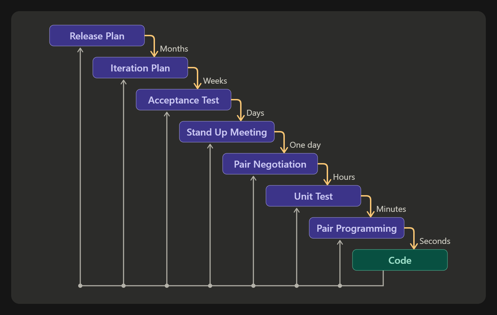

### 3. Feature Driven Development

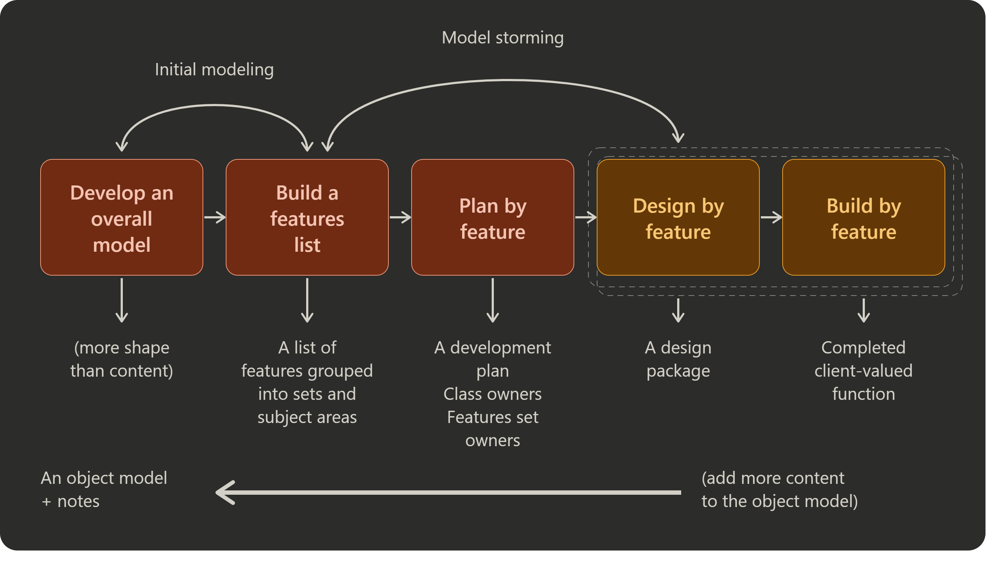

### 4. Agile unified process

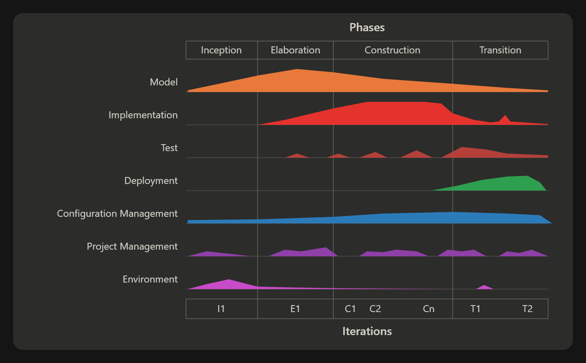

# Pre-class

## SDLC Models

Life is much simpler when you do things just for yourself and by yourself. But this is what life becomes when everyone involved in the software development lifecycle thinks like that:

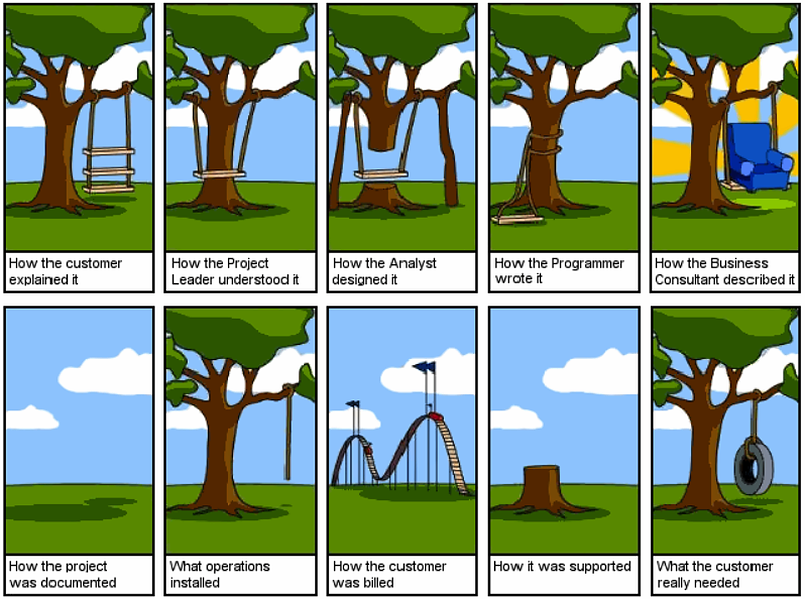

This famous business cartoon, "The Swing Comic," is a powerful metaphor for project failure caused by poor communication. The main idea is that a simple initial request (a swing) is misunderstood and exaggerated by every step of the process. The Project Leader and Programmer create broken, unusable versions. The Business Consultant turns the simple swing into an extravagant, expensive armchair. Meanwhile, the vital documentation is missing, and the customer is billed for a complicated roller coaster that was never requested. The final irony is that after all the effort and expense, what the customer truly needed was just a simple, effective tire swing. The comic highlights a critical failure to properly listen and deliver a focused solution.

So how do you endure this software engineering with other people? You stick to a process model, and make sure that everyone doing the software engineering with you also sticks to it. And make sure that everyone knows where and everyone is progressing on that model in real-time. Now there are two main types of processes:

## Waterfall Models

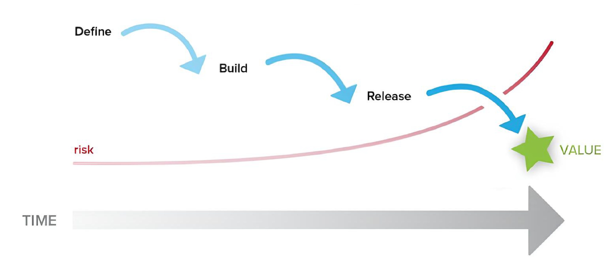

The Waterfall model is a sequential, linear approach: Define, Build, Release. This means the full value is delivered in one large event at the very end of the timeline. The risk naturally increases throughout the project, as major issues are only discovered and addressed late in the final release phase.

Waterfall is a linear and sequential approach to project management. It follows a structured flow of phases, with each phase dependent on the completion of the previous one:

- Start by defining all the requirements upfront.
- Then build the entire product.
- Finally, release it all at once.

You don't see the full value of the project until the very end. This approach also carries a higher risk, as any problems or changes in requirements discovered late in the process can be very costly and difficult to rectify.

## Agile Models

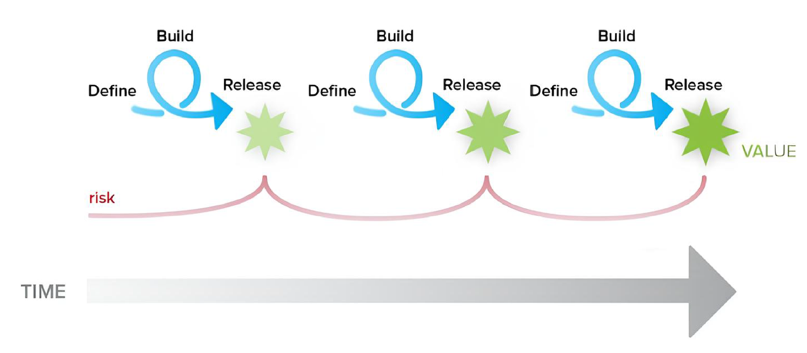

The Agile model uses short, repeating cycles of Define, Build, and Release. This delivers value frequently and early, but is incomplete until the end of the timeline. The approach manages risk by mitigating it after each small release, preventing it from accumulating and ensuring continuous feedback and adaptation.

Agile is a flexible and iterative approach to project management. Instead of one long, linear process, it breaks the work into smaller, iterative cycles called sprints:

- In each sprint, you define, build, and release a small, working part of the product.
- You continuously adapt the project based on the customers' feedback and changing requirements.

Agile welcomes changes in requirements, even late in the development process, to deliver a product that aligns better with the customers' needs. However, continuous changes can introduce scope creep, and flexibility can make it challenging to predict timelines and budgets.

## V-model

The V-model is another linear model with each stage having a corresponding testing activity. Such workflow organisation implies exceptional quality control, but at the same time, it makes the V-model one of the most expensive and time-consuming models.

Moreover, even though mistakes in requirements specifications, code and architecture errors can be detected early, changes during development are still expensive and difficult to implement. As in the Waterfall case, all requirements are gathered at the start and cannot be changed.

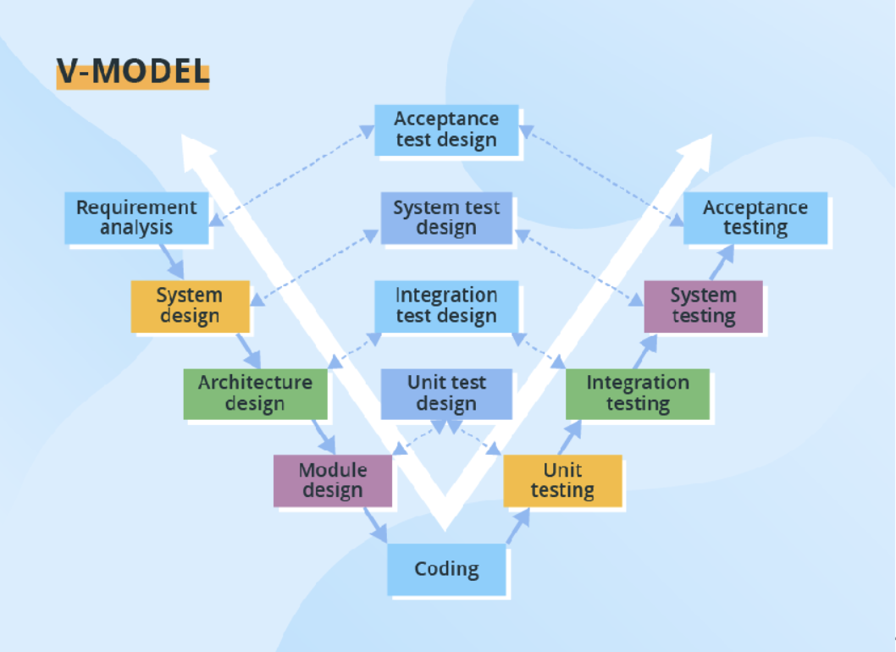

This diagram illustrates the V-Model, a sequential project lifecycle where development and testing phases are paired. The left side flows downward from Requirement Analysis through various design stages to Coding. The right side rises through corresponding testing phases—from Unit Testing up to Acceptance Testing—with dotted lines connecting each development stage to its specific verification stage.

## Spiral model

The Spiral model puts focus on thorough risk assessment. Thus, to reap the benefits of the model to the fullest, you'll need to engage people with a strong background in risk evaluation.

A typical Spiral iteration lasts around 6 months and starts with 4 important activities - thorough planning, risk analysis, prototype creation, and evaluation of the previously delivered part. Repeated spiral cycles seriously extend project timeframes.

This is the model where intensive customer involvement appears. They can be involved in the exploration and review stages of each cycle. At the development stage, the customer's amendments are not acceptable.

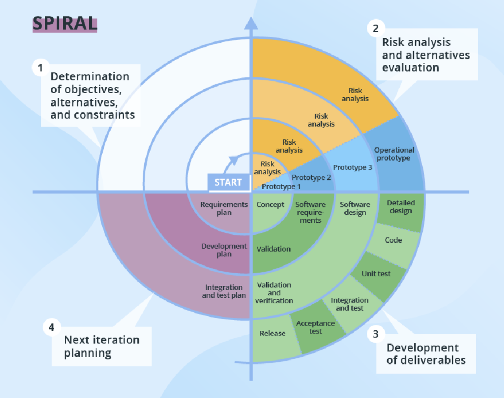

This circular diagram illustrates the Spiral Model, an iterative software development method that focuses on risk management. The process moves outward in cycles, starting with Determination of objectives, followed by Risk analysis and alternatives evaluation (including prototypes), then Development of deliverables (design, code, and testing), and concluding with Next iteration planning. The expanding spiral shows the project growing in scope and refinement with each cycle.

## Further Reading

- [Agile Manifesto – Principles](https://agilemanifesto.org/principles.html)
- [AUP video (YouTube)](http://www.youtube.com/watch?v=vmGMpME_phg&feature=related)
- [Software Engineering Institute's CMMI website](http://www.sei.cmu.edu/cmmi/)
- [AUP – Ambysoft](http://www.ambysoft.com/)
- [XP – Azzurri](http://www.azzurri.co.jp/)
- [Top 12 software development methodologies and its advantages/disadvantages – TatvaSoft](http://www.tatvasoft.com/blog/top-12-software-development-methodologies-and-its-advantages-disadvantages/#anchor5)
