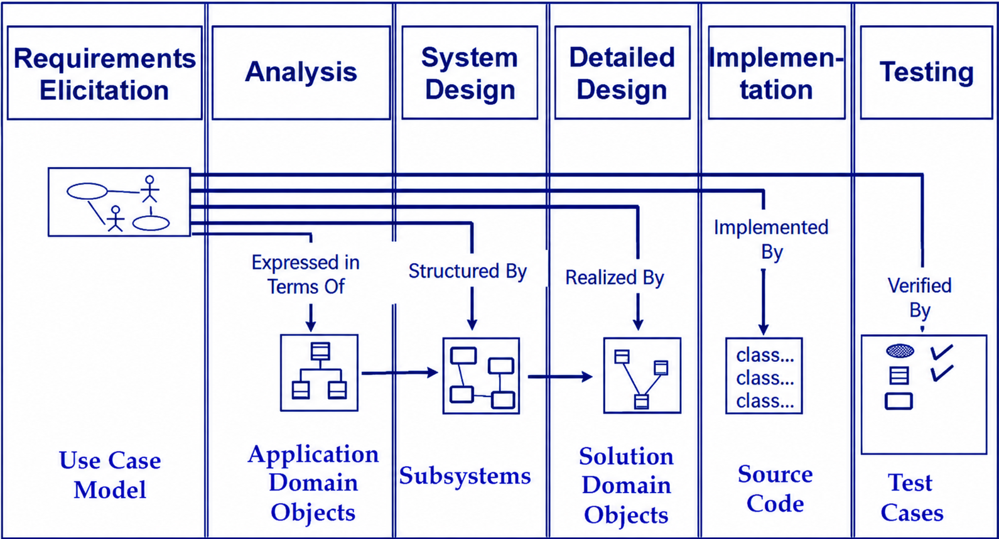
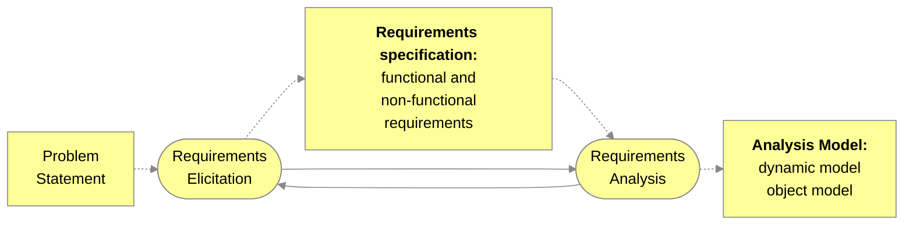
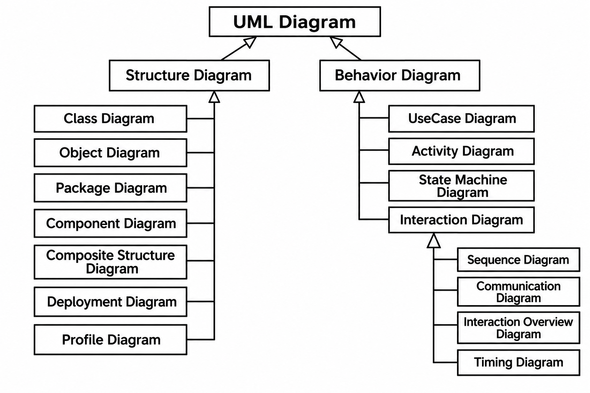
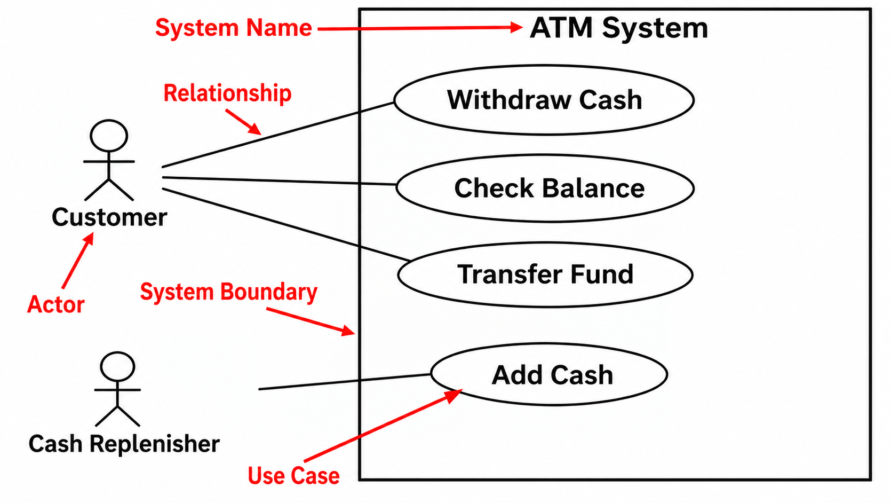
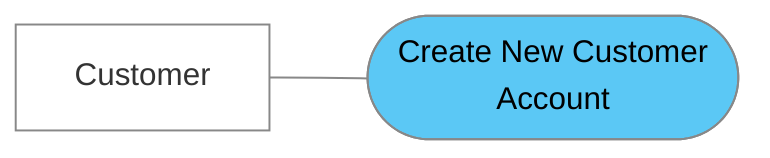

# Week 03 - Engineering Requirements

## Software Lifecycle Activities



### What does the Customer say?

A sign says: "A bird in the the bush".

Look at the sign again: The word “THE” is there twice, but most people read it as “A bird in the bush” and never notice.

The reason is that your brain doesn’t read every word. It guesses what a familiar phrase should say and skips the rest.

The same thing happens with customers. When a customer tells you what they want, you hear what you expect to hear. The customer also assumes you understand, so small mistakes and missing details go unnoticed. Two people can read the same requirement and each see something different.

> Don’t just accept the first thing the customer says. Ask questions, check with them, and review the requirements carefully before you build anything.

## What is Requirements Engineering?

- The process of discovering, documenting, and maintaining system requirements.
- Why does it matter?: To ensure software meets stakeholders' needs.
- Establish a bridge between the user's expression of needs and the developer's blueprint for development.

**Stakeholders** → **Requirements** → **System Design**

### Requirements process



### What are the activities in the requirements process?

- Problem Statements
  - Define what is required by & for the user.
  - e.g.: "System shall respond immediately"
- Requirements Specification
  - Restate the definition in formal terms for the designer
  - e.g. "Query results will display within 3 seconds
- Validate, review, and approve by all before moving on to design.

### Requirements engineering process

- The process of establishing the **services** that a customer requires from a system and the **constraints/limitations** on the services.
  - One of the important steps during software development
  - If we do not collect the right requirements, we are not going to build the right system.
- The system requirements are the descriptions of the system **services** and **constraints** that are generated during the requirements engineering process.

### Types of requirements

- User requirements
  - Statements in natural language plus diagrams of the services the system provides and its operational constraints.
- System requirements
  - A structured document setting out detailed descriptions of the system's functions, services and operational constraints. Defines what should be implemented so may be part of a contract between client and contractor.

Is it true to say a "user requirement" can lead to several system requirements?

### User and system requirements in Mentcare system

**Step 1: User requirements definition**

1. The Mentcare system shall generate monthly management reports showing the cost of drugs prescribed by each clinic during that month.

**Step 2: System requirements specification**

1. On the last working day of each month, a summary of the drugs prescribed, their cost and the prescribing clinics shall be generated.
2. The system shall generate the report for printing after 17.30 on the last working day of the month.
3. A report shall be created for each clinic and shall list the individual drug names, the total number of prescriptions, the number of doses prescribed and the total cost of the prescribed drugs.
4. If drugs are available in different dose units (e.g. 10mg, 20mg, etc) separate reports shall be created for each dose unit.
5. Access to drug cost reports shall be restricted to authorized users as listed on a management access control list.

## Functional and non-functional Requirements

- Functional requirements
  - Statements of services the system should provide, how the system should react to particular inputs and how the system should behave in particular situations.
  - May state what the system should not do.
- Non-functional requirements
  - Constraints on the services or functions offered by the system such as timing constraints, constraints on the development process, standards, etc.
  - Often apply to the system as a whole rather than individual features or services.

### Functional Requirements – ATM Examples

1. The ATM system shall check the validity of the inserted ATM card.
2. The ATM system shall validate the PIN number entered by the customer.
3. The ATM system shall allow the customer to transfer money from one account to another account.
4. The ATM system should not allow the customer to withdraw more than $2000 per 24 hours.

### Non-Functional Requirements – ATM Examples

1. The ATM system shall be written in C++.
2. The ATM system should use MySQL as the main database.
3. The ATM system shall validate an ATM card in less than three seconds.
4. The ATM system shall validate a PIN in less than five seconds.

> Which one is more important/critical?<br>Functional or Non-functional Requirements? Why?

## Requirements elicitation and analysis process

### The requirements elicitation and analysis process

The process is iterative:

1. Requirements discovery
2. Requirements classification and organization
3. Requirements prioritization and negotiation
4. Requirements specification

### Requirements elicitation

- How do we find out what the systems should do?
  - Guess, Experience, Prototype
  - Find out how the current system works
  - Ask the people (we must interact with people)
- Tools
  - Interview, where you talk to people about what they do.
  - Observation, or ethnography, where you watch people.
  - Survey, where you gain input from a large number of people.
  - Brainstorming, users or stakeholders come up with ideas or requirements that they have seen or experienced elsewhere

### Techniques to elicit requirements

Bridging the gap between end user and developer:

- Scenarios: Describe the use of the system as a series of interactions between a concrete end user and the system
- Use cases: Abstractions that describe a class of scenarios

## Scenario-Based Design

- Scenarios can have many different uses during the software lifecycle:
  - Requirements Elicitation: As-is scenario, visionary scenario
  - Client Acceptance Test: Evaluation scenario
  - System Deployment: Training scenario

```text
Designing can range between two approaches:

- **Designing with:** designers work together with users and stakeholders, who help make decisions.
- **Designing for:** designers decide on behalf of users, based on what they think users need.

These are two ends of one scale, not separate choices. In Scenario-Based Design, scenarios help the team work with users to find requirements instead of guessing.
```

### Scenarios - Example

- User Says: A customer comes to the counter with the product. I look for the barcode on the product and scan it. The price shows up on the register along with the total price for all the items I've scanned.
- Questions you could ask to find other Scenarios:
  - What happens if the product doesn't have a bar code?
  - What happens if the bar code doesn't work?
  - What happens if your customer brings multiple items of the same product?

### Scenarios - Example Feedback to Answers

- Answer (No barcode): When the product doesn't have a bar code, I lookup the product on this sheet and type in a special number using the keypad (keyboard).
- Answer (Barcode broken): I type the barcode in by hand using the keypad (keyboard).
- Answer ((Multiple): I count the quantity of the same product, type the quantity in the keypad and then scan the barcode for one.

> Do you think requirements elicitation is a difficult or easy task?

## UML – Unified Modeling Language

The Unified Modeling Language (UML) is a standard language for specifying, visualizing, constructing, and documenting the artifacts of software systems, as well as for business modeling and other non-software systems.

The UML represents a collection of best modeling practices that have proven successful in the modeling of large and complex systems.

### Classification of UML



### UML Diagrams

- Structure diagrams show the static structure of the system and its parts on different abstraction and implementation levels and how they are related to each other.
  - The elements in a structure diagram represent the meaningful concepts of a system and may include abstract, real-world, and implementation concepts.
- Behavior diagrams show the dynamic behavior of the objects in a system, which can be described as a series of changes to the system over time.

## Use Case Diagrams

Purpose: Capture interaction between users (actors) and the system.

Key Elements: Actor, Use Case, System Boundary



### Use Case Model

Four components:

- System boundary: a box drawn around the use cases to denote the edge or boundary of the system being modelled. This is known as the subject in UML2.
- Actors: roles played by people or things that use the system.
- Use cases: things that the actors can do with the system.
- Relationship: meaningful relationships between actors and use cases.

### Use Case Specification - Template

| Field | Description |
|---|---|
| Use case name | Short, descriptive verb phrase in Upper Case |
| Use case ID | A unique ID for each use case; |
| Brief description | A paragraph that captures the goal of the use case; |
| Primary actors | Actually trigger the use case; |
| Secondary actors | Interact with the use case after it has been triggered. They do not trigger the use case. |
| Preconditions | These are things that must be true before the use case can execute -they are constraints on the state of the system; |
| Main flow | The steps in the use case; |
| Postconditions | Things that must be true at the end of the use case; |
| Alternative flows | A list of alternatives to the main flow. |

### Write a Use Case Specification for this diagram



#### Use Case Specification: Example

**Use Case: Create New Customer Account**

| Field | Description |
|---|---|
| ID | 5 |
| Brief description | This system creates a new account for the Customer. |
| Primary actors | Customer |
| Secondary actors | None |
| Preconditions | None |
| Main flow | 1. The use case starts when the Customer selects "New Customer Account"<br>2. The systems asks the Customer to enter their details comprising email address, password, and password again for confirmation.<br>3. The system validates the Customer details.<br>4. The System creates a new account for the Customer. |
| Postconditions | A new account has been created for the Customer. |
| Alternative flows | Invalid Email Address<br>Invalid Password<br>Cancel |

## Alternative Flow Specification: Example

**Alternative flow: Create New Customer Account: Invalid Email Address**

| Field | Description |
|---|---|
| ID | 5.1 |
| Brief description | This system informs the Customer that they entered an invalid email address. |
| Primary actors | Customer |
| Secondary actors | None |
| Preconditions | The Customer has entered an invalid email address. |
| Alternative flow | 1. The alternative flow begins after the Step 3 of the main flow.<br>2. This system informs the Customer that they entered an invalid email address.<br>3. The system shows the correct format of an email address to the Customer.<br>4. The system asks the Customer to try it again. |
| Postconditions | None |

**Alternative flow: Create New Customer Account : Cancel**

| Field | Description |
|---|---|
| ID | 5.2 |
| Brief description | This Customer cancels the account creation process. |
| Primary actors | Customer |
| Secondary actors | None |
| Preconditions | None. |
| Alternative flow | 1. The alternative flow begins at any time.<br>2. The Customer cancels account creation. |
| Postconditions | A new account has *not* been created for the Customer. |

## User Stories and Acceptance Criteria

- A user story is a brief description of a software feature written from the perspective of the end user.
- It's a common tool used in agile software development methodologies to capture the what, why, and who of a new feature.
- The user: Who is the user requesting the feature? This could be a customer, an employee, or any other person who will interact with the system.
- The goal: What does the user want to achieve with the feature? This should be a specific and measurable objective.
- The benefit: Why does the user want this feature? What problem does it solve or what value does it provide.

"As a [user role], I want to [goal], so I can [reason]."

### What is acceptance criteria?

- Are the conditions that a product, user story, or increment of work must satisfy to be completed.
- They are a set of clear, concise, and testable statements that focus on providing positive customer results.
- Acceptance criteria don't focus on how you reach a solution but rather on the final desired outcome of the task.

**Example**:

User story: As a registered user, I want to be able to log in to the website using my email address and password so that I can access my account and manage my purchases.

Acceptance Criteria:

- The login form should be accessible on the website's homepage and other relevant pages.
- Users should be able to enter their registered email address and password.
- Upon successful login, users should be redirected to their account dashboard.
- The system should display an error message with clear instructions for invalid login attempts (e.g., incorrect email address and password).

### Comparing Use Cases & User Stories

| Aspect | Use Case Diagrams | User Stories |
|---|---|---|
| Format | UML Diagrams (Actors, Ovals, System) | Short text statements ("As a …, I want … so that …..") |
| Strengths | Good overview, structured, scalable | Simple, fast, user-centered, flexible |
| Weaknesses | Requires UML knowledge, less agile | Can be vague, lacks big-picture structure |
| Best For | Large, formal projects | Agile, iterative development |

# Pre-class

## Requirements Engineering

You may think understanding what the client wants is simple — just ask the client themselves! 

But before you do so, consider this scenario: Imagine you are building an appointment booking system for a real estate agent.

Rely entirely on the client to write the requirements themselves, and the software development team will end up with a list that runs up to hundreds of pages, written in the most reader-unfriendly language — and that still doesn't guarantee the list is complete. To be able to proceed with a sensible and comprehensible Software Requirement Specifications (SRS) document, you will need to do some requirements engineering.

### Requirements Engineering Activities

Requirements engineering helps identify precisely the problem that the client need solved, their criteria and constraints for the solution. Many times, the project has direct and non-direct users that are not the client themselves, so you will have to involve other stakeholders in the requirements engineering process as well. Depends on the project type and the organisation's practice, requirements engineering activies may include:

- Elicitation: Developers and stakeholders meet; the latter are inquired concerning their needs and wants regarding the software product.
- Negotiation: Requirements are identified (including new ones if the development is iterative), and conflicts with stakeholders are solved.
- Validation: Checking that the documented requirements and models are consistent and meet the stakeholders' needs. Only if the final draft passes the validation process, the SRS becomes official.
- Management: Managing all the activities related to the requirements since inception, supervising as the system is developed, and even until after it is put into use (e. g., changes, extensions, etc.)

Since "a sensible and comprehensible SRS document" is the desired outcome of requirements engineering, you need to involve documentation throughout the whole process.

### Functional and Non-Functional Requirements

| | Functional Requirements | Non-Functional Requirements |
|---|---|---|
| Definition | Statements of services the system should provide, how the system should react to particular inputs and how the system should behave in specific situations. | Constraints on the services or functions offered by the system, such as timing constraints, constraints on the development process, standards, etc. |
| Scope | May state what the system should not do. | Apply to the system as a whole rather than individual features or services inside it. |
| Examples | User authentication, admin function, reporting capabilities | Response speed (e.g. sending real-time notifications), security, reliability |

## User Story vs Use Case

As you elicit and negotiate the requirements with the client, sometimes a visualisation of what you will develop for the system or an attempt to frame the problem from their perspective may make the process easier.

### User Story

Used for Agile projects

User stories reflect the user's point of view not from the developer, tester or admins' point of view. Therefore, it should be written in user's language, or plain language, not in technical language.

Structure for a User Story: User's name + wants + benefit

As a [description of user], I want [functionality] so that [benefit].

Examples:

- As a poster I want to post a new story so I can share my opinion.
- As a poster I want to edit my story so my story reflects correctly my opinion over time.
- As a reader I want to comment so I can engage with the original poster.

Acceptance criteria - expectation of users/stakeholders

Epic story vs Vague story needs to be decompose into smaller user stories

Decompose this epic story into several features using a "user story". You may create as many user stories as you see necessary.

Include acceptance criteria for each user story.

"As a Shop Owner, I want to provide net shopping to customers, so that they can perform various transactions."

### Use Case

Used for non-Agile projects

A Use Case is a textual description of the functionality provided by the system.

Specifies how a user interacts with a system and how the system responds to the user actions.

A Use-Case model consists of a number of model elements. The most important model elements are:

- Use Cases,
- Actors
- and the relationships between them.

Structure of Use case model, including Actor, Use Case name. It comes with a table that details the use case description, pre-condition, post-condition, basic path, alternative paths and exception paths.

## Requirement Engineering in Action

University Library System

Scenario:

A university plans to implement a digital library system where students can search for books, borrow them online, and receive reminders before due dates. Libraries need to add new books, manage borrowing records, and handle overdue fines.

A use case diagram illustrates these system interactions, such as "Borrow Book", "Search Catalog", "Renew Loan", and "Generate Fine Reports".

In contrast, user stories emphasise the human side: "As a student, I want to renew books online so that I avoid late fees" or "As a librarian, I want to generate reports so that I can track the most borrowed books".

Questions:

- If you were leading this project, which requirement engineering activities would you use first, and why?
- Do you think combining use case diagram and user stories help produce a stronger requirements specification? Why so?
